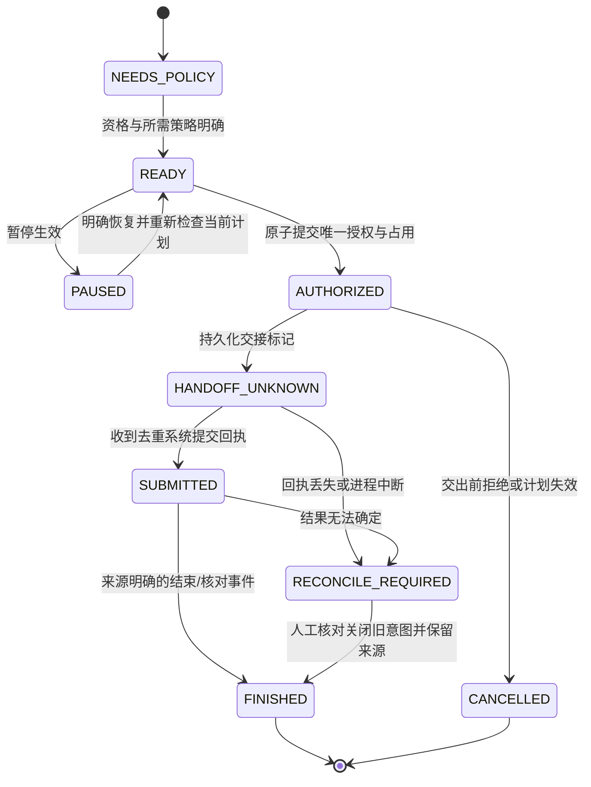

# 销售拨号助手：行为规范 v0.1

日期：2026-10-14；阶段：步骤3。项目固定为`D:\mx\AI-Workspace\Projects\sales-dialer`。依据[原始需求](project-brief.md)、[已采纳决定](decisions.md)、[平台证据](research.md)及本轮用户答复。规范与后续已采纳决定持续更新；具体通过范围见acceptance。

MUST=必须满足；MUST NOT=禁止；SHOULD=可说明理由后取舍；MAY=可选。它们约束选定行为，与台账MoSCoW交付优先级分别维护。R-CALL ID保持稳定；[test-matrix.md](test-matrix.md)维护T-CALL关联。步骤5已实现M-CALL-001～005的本地共用逻辑、M008合成管理接口与M009仿真容量，131项回归通过。平台和生产条件仍待验证；工程接口见[simulation-contract](simulation-contract.md)。

## 已确定范围与本轮边界

- 企业内部销售，目标是中国大陆企业联系人。名单由mantou搜索取得，mantou已确认有联系资格或同意记录；不再索要原始证明，业务状态记录“用户/企业确认”，不冒充AI审核。
- 销售SIM主动拨出，接收端看到销售手机号，双卡；已提供中国电信销售拨出号，受控测试同意已报告。原Android+iPhone自动拨号目标保留。
- 北京时间09:00至18:00，Asia/Shanghai（东八区）。支持人工立即拨下一条及修改计划时间，人工触发同样遵守拨打时段。
- 第一阶段不自动重拨，未接/忙线/拒接后由销售决定是否再次尝试。每人每天约200次总拨号尝试，含人工再次尝试；不是200个不同号码，不是全部接通，也不是硬上限。
- 固定语音/意愿确认/销售接手在后续独立轮次。当前不选云回拨或辅助拨号替代原范围。

本轮可独立实现范围是共用规则、合成任务与测试替身：时段、资格/拒绝联系、版本、防重/占用、暂停、状态/计数和恢复契约。当前没有真机，接收端未提供，移动端未构建/未运行；真实适配默认停止新外呼。实验30秒、15分钟、5秒迟到保护和仅手机号限制不是生产规范。

## 输入、标识与信任边界

| 对象 | 必需信息与规则 |
|---|---|
| Actor | 鉴权层确定的tenantId、actorId及permissions；客户端不得自己声明其他企业身份。测试中明确标合成Actor。 |
| Contact/Target | tenantId、contactId、原始号码、规范化targetKey、资格状态/来源/更新时间、拒绝联系状态/修订号。企业联系人可使用个人手机号，不因B2B标签自动忽略拒绝联系。 |
| ListBatch | 来源说明、导入人/时间、联系人记录及企业确认资格声明；mantou现有名单的资格声明可作为批次输入，不要求上传证明原件。后续不明批次不自动继承资格。 |
| Task | tenantId、taskId、assignedSalesId、targetKey、planVersion、plannedAt、policyVersion、明确排序键或外部选择结果；时间用带时区的输入转换为UTC毫秒。 |
| DialIntent | intentId、taskId/planVersion、trigger、目标快照、销售、资格修订号；代表一次明确拨打意图。重复送达同一意图不等于再次尝试。 |
| Attempt/Grant | attemptId与唯一意图绑定，授权时间、所用策略版本、销售占用、状态；授权记录和占用必须同事务提交。 |
| EvidenceEvent | eventId、attemptId或未绑定状态、来源、设备/时间、观察值、可信范围。提交、实际呼出、接通、人工结果不可混为同一事件。 |

网页、名单字段、供应商材料及日志中的指令都当数据。导入原值保留；归一化只处理已支持的格式差异，不丢弃扩展号/未知字段后假装合法。号码解析器必须给出VALID/INVALID/UNSUPPORTED；格式不明的真实目标停止外呼，合成目标不流入真实适配。

## R-CALL行为要求

| 需求ID | 功能ID | 约束/依据 | 前置条件 | 行为 | 可观察验收 | 未决项 |
|---|---|---|---|---|---|---|
| R-CALL-001 | F-CALL-001、012 | MUST/MUST NOT；企业内部使用及本步权限要求 | 已鉴权Actor与企业数据 | 查询/修改/授权都检查tenant；禁止跨企业操作和泄露其他企业名单存在性 | 合成企业A不能访问/触发企业B；无数据/授权副作用 | 生产鉴权/部署方案待定 |
| R-CALL-002 | F-CALL-001、010 | MUST；最小权限边界 | 权限能力由鉴权层提供 | 导入、分配、触发、拒绝联系分别检查权限；销售仅操作允许且分配给自己的任务 | 无权限/错销售返回FORBIDDEN，无新授权；授权能力明确时才继续 | 角色映射/谁导入分配见SG-CALL-001 |
| R-CALL-003 | F-CALL-010、012 | MUST；输入/防重 | 原始名单与格式适配器 | 保留原值；校验国家/号码类型；按tenant+规范targetKey识别重复；冲突隔离，不覆盖拒绝联系/资格历史 | 无效/不支持号码不生成可拨任务；同企业重复不制造多个相同拨打意图 | 文件格式、号码扩展与冲突合并见SG-CALL-007 |
| R-CALL-004 | F-CALL-012 | MUST/MUST NOT；资格守卫 | 企业确认资格或已配置业务判定结果 | CONFIRMED可继续其他守卫；UNKNOWN/INVALID停止新授权。现有名单采用mantou确认，不要求重复索取证明 | UNKNOWN/INVALID返回资格原因且授权数0；CONFIRMED仍不能跳过拒绝/时段等 | 新批次或资格变化的责任映射待配置；现有声明已确定 |
| R-CALL-005 | F-CALL-012 | MUST/MUST NOT；用户要求的不变量 | 该tenant+targetKey的拒绝联系记录已提交 | 该目标不再获得新拨打授权；重导入/重拨/不同销售不绕过；提交前复核修订号 | 拒绝提交后每个新授权事务均拒绝；导入不清除拒绝；日志留顺序 | 跨号码/联系人合并与跨企业共享不自动决定 |
| R-CALL-006 | F-CALL-005 | MUST；本轮时段答复 | 有效UTC毫秒时刻与触发类型 | 按Asia/Shanghai检查拨打时刻09:00≤t<18:00；人工与定时同规则；时段外不授权 | 08:59:59.999拒绝，09:00允许时段，17:59:59.999允许时段，18:00拒绝；主机时区不影响 | 日期/节假日见SG-CALL-002；窗口通过不等于全授权 |
| R-CALL-007 | F-CALL-005、011 | MUST；预定调度与旧计划失效 | 有已确定时间/策略/planVersion的任务 | 定时事件携带版本；旧版本、取消任务和过期策略不得授权；计划变化增版本 | v1事件遇到v2拒绝，不创建attempt；当前版本仍重新检查所有守卫 | 迟到/过期处理见SG-CALL-003 |
| R-CALL-008 | F-CALL-005、011 | MUST；人工立即拨下一条 | 明确选中的下一任务及Actor，销售无占用 | 立即请求仍检查时段/资格/拒绝/版本/权限；与同一待执行意图竞争只能一通 | 定时/人工交错只产生一个可消费授权；忙时不拨，不跳过其他守卫 | “下一条”排序/忙时是否保留命令见SG-CALL-004 |
| R-CALL-009 | F-CALL-005、011 | MUST；人工修改计划时间 | 有修改权限，任务尚可更改 | 目标拨打时间必须在窗口内；更改增版本，旧事件失效；已交给电话系统的请求不能靠改计划撤回 | 旧回调拒绝，新版本留审计；窗口外目标不能变成可拨计划 | 窗口外修改操作、已提交任务的编辑展示见SG-CALL-004 |
| R-CALL-010 | F-CALL-005、007、011 | MUST NOT/MAY；用户已采纳无自动重拨 | 本次终结为未接/忙线/拒接/失败 | 不自动产生重拨意图；销售可明确创建新意图，重新走全部守卫。明确拒绝联系仍禁止 | 结果入库后无自动重拨任务；销售再次尝试有新intentId，计数分开 | 再次尝试次数/间隔如要限制需另决定 |
| R-CALL-011 | F-CALL-011 | MUST；暂停/恢复 | 明确暂停scope与当前任务版本 | 暂停生效后不再授权该scope新尝试，未交出的grant撤销；恢复不补放旧事件，需当前计划/策略 | 暂停后定时/人工均不新授权；旧事件在恢复后仍失效 | 暂停scope与过期任务恢复见SG-CALL-005 |
| R-CALL-012 | F-CALL-006、011 | MUST；销售占用 | 同一权威Store记录销售/任务占用 | 一个销售最多一份未终结呼出授权；真实执行再检查设备实际占用，其他卡来电也不能被忽略 | 多任务/设备竞争只一份占用；busy/状态未知阻止真实新请求 | 占用租期不是未知请求可重放许可 |
| R-CALL-013 | F-CALL-005、011 | MUST；重复不重复授权 | taskVersion/intentId稳定 | 同一意图/事件重投返回原结果或重复拒绝，不创建新attempt；同任务同周期用唯一约束 | 重复事件/并发授权数至多1；新人工重拨必须显式新意图 | 幂等保留期限见SG-CALL-006 |
| R-CALL-014 | F-CALL-011、013 | MUST/MUST NOT；持久化与失败 | 权威事务Store可用 | 检查最新版本/资格/拒绝并提交attempt、占用和审计/outbox必须原子；写入失败不得调用适配器 | 故障注入回滚全部状态，无adapter调用；提交后有可恢复记录 | 生产存储/多机部署能力待独立验证 |
| R-CALL-015 | F-CALL-011、013 | MUST/MUST NOT；未知不重放 | durable grant待消费，准备跨进程/设备交出 | 消费前再次检查当前资格/版本/暂停/时段/占用；先持久化交接标记再外部请求；丢回执进入待核对，不自动再次调用 | “已可能交出但无结果”重启后仍待核对，原attempt不再调用adapter | 系统呼叫无法与本地事务原子化，见边界说明 |
| R-CALL-016 | F-CALL-011、013 | MUST；恢复/人工核对 | 有任务状态和来源明确的核对事件 | 恢复暂停/拒绝/版本/占用/事件去重；未知状态不能被进程重启清空。人工核对保留原未知结果与来源 | 不把设备IDLE改成“未呼出”；新人工意图需要明确核对且全部守卫重新成立 | 核对操作角色、超时提醒与升级策略待定 |
| R-CALL-017 | F-CALL-006、013 | MUST/MUST NOT；状态来源边界 | API回执、设备观察或人工输入 | API提交、实际呼出、客户接通、人工结果分字段；未绑定任务的状态仅观察，不更新客户接通数 | Android OFFHOOK/iOS open成功不计接通；任意CXCall未验证绑定不归属客户 | 真机任务关联与接通来源仍待步骤2 |
| R-CALL-018 | F-CALL-007、013 | MUST/MUST NOT；日量澄清 | 去重的意图/attempt/证据事件 | 不同号码U、授权尝试G、系统提交Q、已证实呼出O、已证实接通C分别统计；重复事件不多计；约200不自动成为上限 | 两个目标三次人工意图可U=2/G=3；设备证据未知时O/C不被填成通过 | 日“总拨号”主指标采用Q或O、营业日边界见SG-CALL-008 |
| R-CALL-019 | F-CALL-002、008 | MUST；销售SIM/显号原要求 | 经过明确配置/验证的SIM适配 | 使用销售手机号所在SIM；选卡不明/不可用不得静默换卡；客户显号必须由接收端证据验证 | 指定卡与实际呼出/显号一致的受控证据；无证据保留未验收 | 双卡绑定策略与iOS选卡能力见SG-CALL-009 |
| R-CALL-020 | F-CALL-003 | MUST；Android原目标 | 权限、设备、地区/ROM及线路条件具备 | 直接呼出/前后台/锁屏/占用/撤权/接续分别验证；接口提交不是通话完成 | 完成manual-steps中相关场景，记录版本/设备/退出码/接收端 | Android已构建；S23 Ultra三个受控场景取得有限证据，完整故障/长期条件见真机报告 |
| R-CALL-021 | F-CALL-004 | MUST；iPhone原目标 | 满足大陆地区/签名/权限与真实SIM条件 | 保留自动程度；普通tel确认/快捷指令只作探索，未经采纳不得按降级范围验收 | 免逐通确认路径与调度/状态/显号有实际证据后才验收对应范围 | 公开tel需确认；默认dialer地区边界，仍待验证 |
| R-CALL-022 | F-CALL-010 | MUST/SHOULD；名单/分配最小链路 | 有导入/分配权限及已配置分配规则 | 导入不自动拨号；分配变更在授权前复核，销售不得触发别人的任务；建议显示导入错误/冲突清单 | 不符合行隔离；重分配后旧销售无法新授权；无输入泄露跨tenant | 管理员/销售导入角色与批量格式待定 |
| R-CALL-023 | F-CALL-001、012、013 | MUST/SHOULD；日志与保留 | 已配置访问和保留策略 | 审计记录Actor/版本/原因/事件来源；版本化日志用掩码/合成标识。保留期限未定不宣称已合规设置 | 常规日志不含完整客户名单/销售号；越权不能读取；删除/幂等历史关系可检验 | 联系/日志/拒绝记录分别保留策略见SG-CALL-006 |
| R-CALL-024 | F-CALL-003、004、011 | MUST/MUST NOT；真实适配守门 | mode=simulation或real明确 | 默认simulation只用合成输入/记录请求替身；real资格/政策/设备/线路/授权缺任一项停止新外呼，不自动切路径 | 仿真0真实电话API调用；缺真实环境返回REAL_ADAPTER_UNAVAILABLE | 本轮Android受控3通已结束；正式真实适配、iOS/Mac及剩余平台证据仍缺 |
| R-CALL-025 | F-CALL-009 | MUST NOT；本轮范围 | 第一阶段 | 不在本轮加入固定语音/意愿识别/转接；独立轮次先验媒体与接手链路 | 台账保留后续条目，不把普通通话接口当语音注入证据 | 后续轮次需求/计费未定 |
| R-CALL-026 | F-CALL-005、011、013 | SHOULD；最小操作入口 | 共用模拟链路具备 | 显示任务/暂停/待核对/请求状态与证据来源，避免“提交成功=拨通”；人工动作由已采纳策略驱动 | 启停与结果可操作；当前能做/未运行范围清楚 | 最终移动UI与管理角色尚待确定 |
| R-CALL-027 | F-CALL-007 | MUST；容量验证方式 | 合成数据、可注入时钟/测试替身 | 约200任务/尝试先跑仿真容量与防重，真实日量另需试点，不把200不同号码当用户要求 | 可复现实验明确不同目标数、尝试数、耗时、异常与0真实调用 | 合成容量已运行；真实试点与费用待条件 |
| R-CALL-028 | F-CALL-001、010、012 | MUST / MUST NOT | 可信企业/销售身份；D018销售自助模式 | 销售自行导入、仅查看和处理本人名单/任务、只能为自己建任务；拒绝跨销售分配/操作。本人未建任务的导入联系人可见，其他导入人的历史不外泄，企业拒绝状态跨销售保留 | T098～100与生产鉴权/端到端验证；无权请求状态不变 | 生产身份认证和真实格式仍待实现；本地固定合成身份不替代 |
| R-CALL-029 | F-CALL-005、011 | MUST / MUST NOT | D019；Asia/Shanghai，当前任务/策略版本可核查 | 周一至周五09≤时刻<18；人工同窗口；过时不自动补拨；仅暂停当前销售，恢复需重新安排；busy时立即请求不保存为将来请求 | T104、T056～061、T082、T105；周末计划/触发拒绝，恢复无新请求 | 60秒迟到为实验参数；生产误差阈值/自动排序仍未定；手机调度未验证 |
| R-CALL-030 | F-CALL-003、005、011、013 | MUST/MUST NOT；安卓开发交接子范围 | 已授权合成任务、明确USB设备；真实模式关闭 | 交接前持久完整版本/授权/绑定；主机与手机拒绝非合成/过期命令；回执摘要与身份匹配；未知不重放；设备去重持久化；不把接收当呼出/接通 | T108～115：提交前保存、并发一次、资格/暂停/旧版阻断、回执失败恢复、原生去重与两任务闭环 | [android-handoff](android-handoff.md)；60秒仅实验TTL；生产身份/实时撤回/真实适配未实现 |

## 时段精确定义与首个实现契约

用户确定09:00～18:00。实现采用半开区间`[09:00:00.000,18:00:00.000)`作为边界精度约定：09:00整点可检查为窗口内，18:00整点停止新授权；已经接通的电话不强行挂断。该约定记录为工程细化E-CALL-009，不写成用户逐字回答。不得由手机本地时区覆盖Asia/Shanghai。

首个小项 **M-CALL-001：R-CALL-006时段守卫**。拟定接口`checkDialWindow({ atEpochMs, trigger })`，trigger只接受`scheduled / manual_now / manual_reschedule`，输入UTC毫秒整数且在JavaScript有效Date范围内。missing、NaN、Infinity、非整数、越界或未知trigger返回INVALID_INPUT，不能当窗口内。

输出为`{ decision, reason, timeZone }`，decision只取`WINDOW_OK / OUTSIDE_WINDOW / INVALID_INPUT`，timeZone为Asia/Shanghai。reason使用技术结果码：窗口内WITHIN_WINDOW，09点前BEFORE_WINDOW，18点起AFTER_WINDOW，无效时间INVALID_TIME，无效触发INVALID_TRIGGER；两项输入都无效时先报INVALID_TIME。这些返回码是工程接口细化，不新增产品策略。

它是纯判断，无授权、计数、存储或电话副作用；WINDOW_OK只证明时间条件，不是允许拨号。对改计划检查拟拨时刻，对实际授权/交出检查实际当前时刻。

| 拟测试输入（UTC） | 触发 | 预期 |
|---|---|---|
| 2026-10-14T00:59:59.999Z | scheduled | OUTSIDE_WINDOW（北京时间08:59:59.999） |
| 2026-10-14T01:00:00.000Z | scheduled/manual_now/manual_reschedule分别测试 | WINDOW_OK（09:00）；无授权或电话副作用 |
| 2026-10-14T09:59:59.999Z | 三种触发分别测试 | WINDOW_OK（17:59:59.999） |
| 2026-10-14T10:00:00.000Z | 三种触发分别测试 | OUTSIDE_WINDOW（18:00） |
| 有效时间但未知trigger，或无效atEpochMs | 任意 | INVALID_INPUT，不吞错误生成允许结果 |

测试入口、Clock与首个红灯见[implementation-plan.md](implementation-plan.md)、[test-matrix.md](test-matrix.md)。步骤4的41个目标红灯保留；步骤5原43项全部转绿，追加5项跨日/有效Date端点检查通过。原断言、时段契约和R要求行保持不变，证据见[M-CALL-001结果](../evidence/step-5/M-CALL-001/result.json)。

当前[checkDialWindow](../packages/core/src/dial-window.mjs)只实施上述纯判断；[命令行入口](../packages/core/src/window-cli.mjs)接受UTC毫秒整数和trigger，输出同一结果，不产生授权/电话请求。本地SimulationEngine已组合权限、资格、拒绝、版本、显式仿真日历、暂停和占用守卫；真实适配仍禁用。WINDOW_OK不能代替这些条件。

## 正常、失败与恢复状态

时段外/暂停/资格未知/越权/busy/旧版本返回拒绝原因，当前事件不授权。是否延期、保留或丢弃过期任务依相应SPEC GAP，不自动把拒绝变成重试。READY表示业务前置可检查，不代表真实平台就绪。实际呼出/接通证据是独立事实，不靠上述状态名字推断。

## 不变量与证据边界

| 不变量 | 适用前提/范围 | 需要的可观察证据 |
|---|---|---|
| I-CALL-001 拒绝后不新授权 | 同一tenant+规范targetKey，拒绝与授权在权威Store排序提交 | 拒绝提交序号之后无新grant；并发测试与跨销售/重导入检查 |
| I-CALL-002 旧计划不授权 | 任务版本/暂停或分配修订被权威Store记录 | 旧callback/version返回失效，grant数不变 |
| I-CALL-003 重复不重复授权 | 同一意图/任务周期唯一约束与事务占用 | 重复/并发事件只一份attempt和销售占用 |
| I-CALL-004 未知不自动重放 | 请求可能已经交给电话系统 | 重启/超时仍待核对，原attempt的adapter调用次数不增加 |
| I-CALL-005 时间与权限同样约束人工 | 实际授权/消费时，Asia/Shanghai与鉴权/分配状态可核查 | 18点/越权/错销售的manual_now拒绝，无新grant |
| I-CALL-006 写入失败不外呼 | 授权、占用、审计/outbox原子事务 | 写入故障0提交/0外部请求；已有提交进入可恢复状态 |
| I-CALL-007 仿真不真实外呼 | simulation入口绑定测试替身且不配置真实号码/适配 | 记录请求替身可检验，真实电话入口调用为0 |

本地/服务器事务与手机电话系统不能组成一个原子提交。拒绝在新授权提交前生效必须阻止授权；交出前再次检查。已进入电话系统的呼叫不能承诺被暂停或拒绝瞬间撤回，也不强挂断销售正在讲话的电话；保存顺序、撤销尝试及不再新授权的证据。

对未知结果，人工关闭旧意图不等于证明“未呼出”；保留未知与人工核对来源。只有明确确认无活动/待处理通话、关闭旧占用并创建新的人工意图后，才允许重新检查下一次请求。历史O/C计数不得靠IDLE或人为关闭而自动改成0或1。

## SPEC GAP与可继续部分

| ID | 尚未决定/验证的事项 | 影响与处置 |
|---|---|---|
| SG-CALL-001 | 产品角色已定，生产鉴权待实现 | D018采纳销售自行导入/处理本人名单，无管理员分配默认；可信身份、账号与多企业部署仍待实现和验收。 |
| SG-CALL-002 | 星期规则已定，额外节假日策略未引入 | D019采纳周一至周五09含18不含，东八区。未采用节假日/调休额外规则；未来如需改变再决定。 |
| SG-CALL-003 | 迟到/过期处理、允许误差、计划有效期 | 技术timer参数不当生产默认；版本守卫可实现，真实延期/补执行策略等待输入。 |
| SG-CALL-004 | 自动下一条排序、窗口外编辑计划仍未决 | D019已确定busy时立即请求拒绝且不排队；当前工作台显式选中任务，不假定生产FIFO。 |
| SG-CALL-005 | 已决定暂停/恢复 | D019采纳仅当前销售暂停；恢复不补执行，销售重新安排，过时任务不自动补拨。手机真实恢复仍待验证。 |
| SG-CALL-006 | 联系、尝试、日志、拒绝与幂等记录保留期限 | 不假定7/30/90天；仿真数据可重建，真实数据生命周期策略未定前不启用采集/批量任务。 |
| SG-CALL-007 | 名单文件格式、字段、支持号码类型/分机及冲突合并 | 本轮采用规范化合成记录接口；不把原型只接受手机号的限制改写成原需求。 |
| SG-CALL-008 | 日总拨号主指标与失败提交口径 | 约200总尝试已明确；U/G/Q/O/C分别定义并保留未知，计费/主报表不猜。 |
| SG-CALL-009 | 双卡绑定/切换策略，iPhone程序选卡与免确认能力 | 平台适配与真实验收等待设备/许可/证据；共用逻辑不自动改辅助拨号。 |
| SG-CALL-010 | 企业人数、研发/通话预算、归属地套餐与试点条件 | 估算按标明假设/参数计算；不作询价、采购或交付日期承诺。 |

资格/同意来源已由mantou确认，不再列为向用户索要证明的缺口。软件对后续UNKNOWN状态继续按R-CALL-004停止新授权。真实环境和当前未决策略只阻断相关真实动作，不阻断M-CALL-001或其他输入/预期已经确定的共用规则。

## 步骤5当前实现状态

本地共用范围已具备步骤6验收条件；具体契约/可逆仿真参数见[simulation-contract.md](simulation-contract.md)，操作见[simulation-guide.md](simulation-guide.md)。原业务要求不变，真实格式/角色/保留、生产策略及双端原范围继续保留上述SPEC GAP与证据边界。

## 步骤6当前状态（2026-10-15）

本地仿真软件已通过验收：136项回归/28模块语法/69项原型静态检查及CLI交互通过，两个缺陷红转绿，新增200独立任务容量场景。原完整产品仍部分通过、双端必需证据不足；平台原型未构建/未运行，正式手机适配未实现。前文“待步骤6/进入验收”是历史进度，以[acceptance](acceptance.md)和[next-action](next-action.md)为当前结论。

下一步2补真机/线路/地区证据；条件未具备时可并行3明确生产角色/格式/日历/过期/恢复/保留等行为，再5实现已验证适配，回6验收。不改变原需求。固定语音独立后续台账见[next-round-voice](next-round-voice.md)。

## 当前持续推进边界

D018/D019已实际进入自助权限与工作日守卫，R028/R029补充原规范，不降级原双端自动目标。工作台只模拟外呼，生产鉴权、真实名单格式/保留和正式手机适配仍未完成。Java/SDK缺口已在D020授权后补齐，Android原型已实际构建，运行与真机结论以最新spike/acceptance为准；此前“未构建”保留为历史状态。

## R031/R032：USB开发绑定与网页手机仿真（2026-10-15）

| R/F ID | 规范 | 前置条件与行为 | 验收 | 未决项 |
|---|---|---|---|---|
| R-CALL-031 / F-CALL-003、005、011 | MUST 显式绑定；MUST NOT 自动换机/真实SIM | 开发USB显式序列号；检查连接、API级别、启动标识和已安装APK与本地包哈希；绑定60秒，过期/时钟回退/断连/重启/包变化后需重新绑定。新进程无绑定。提交前再次核验。合成simId固定SYNTHETIC-NO-SIM | T116～119；预检失败零授权；提交后失败沿R030待核对 | 60秒仅开发参数；不代表生产设备认证、真实SIM绑定或电话权限已核验；短暂断连后在检查前恢复不可观测 |
| R-CALL-032 / F-CALL-003、005、011、013 | MUST 隔离手机墙钟/虚拟任务；MUST NOT 自动重放 | 网页独立手机区、独立SQLite及合成销售身份；当前北京时间和工作日守卫；创建合成任务→显式发送→保存手机回执→显式核对；暂停/恢复重新安排和拒绝联系继续生效。没有自动轮询/真实外呼 | T120～125；并发仅一次，未知重开保留，网页身份/同源守卫，物理手机合成E2E | 正式企业身份、账号设备关联、自动定时/下一条、真SIM链路仍未交付 |

能力快照仅报告USB开发合成入口。真实电话权限标NOT_CHECKED、真实SIM标NOT_BOUND；合成可用不能推导真实可用。此版本只有手动单任务发送；不把虚拟任务直接迁移到手机执行。

## R-CALL-033：手机区持久定时仿真（2026-10-15）

关联F-CALL-003/005/006/011，MUST/MUST NOT用于本轮开发子范围：

| 前置/输入 | 行为 | 验收 | 未决项/边界 |
|---|---|---|---|
| 独立手机区的合成任务、显式有效绑定、未来北京时间 | MUST 保存计划ID、任务/策略版本、绑定ID、到点时间及状态；计划时间必须在本次绑定有效期内。改计划使旧计划取消 | T126/127/130 | 当前60秒绑定与1秒授权迟到容差仅开发实验参数，生产迟到未采纳 |
| 服务运行且计划到点 | MUST 先持久领取DISPATCHING，再校验时限、绑定、版本和资格/拒绝/暂停/占用/工作日窗口，最后沿R030授权与交接；MUST NOT 靠界面轮询触发 | T126/131/132/134/135 | 本机250ms轮询；电脑服务/USB必需；不是手机脱机闹钟，亦非真实通话 |
| 暂停、重排、人工先触发、旧版本或过期 | MUST 阻止旧计划；失败或占用只记录BLOCKED，MUST NOT 转空闲后补发或重试 | T127/129/131 | 同时到期按持久记录遍历，但占用仍拒绝；没有生产自动下一条排序 |
| 服务重启、交接未知 | MUST 保留记录，PENDING/DISPATCHING转NEEDS_REPLAN；所有未完成定时均需明确重排，MUST NOT 自动恢复定时。已交接未知仍待核对，不重放 | T128/129/133 | 未来计划也保守重排，这是开发模式恢复规则；生产运行/恢复设计待补 |

到点1秒是授权前的容差，不是手机收取回执时限；USB调用耗时可能超过1秒。再次绑定产生新绑定ID，原定时不自动迁移，必须重新安排。计划保存与任务改版是两次事务；第二次写入失败最多留下已改版但无定时的任务，旧计划因版本检查不能执行，不会半写后发出请求。页面关闭不取消计划，暂停或停止服务才停止后续任务。

## R-CALL-034：电话能力只读快照与账户绑定（2026-10-15）

关联F-CALL-002/003/008/011，MUST读取与真实授权分开：

| 前置与输入 | 规范行为 | 验证方式 | 边界/未决项 |
|---|---|---|---|
| 显式USB设备、匹配的本地debug APK、用户主动读取 | MUST 通过只读Activity取得权限、可呼叫SIM账户、系统通话中状态、精确闹钟与后台/电池设置；MUST NOT 请求权限、改变设置或发起通话；不读取完整号码、原始账户ID/ICCID/IMSI | T140真机读取；源码/构建/lint | API快照不是后台长期可靠性证明 |
| 新读取请求 | MUST 使用随机nonce关联回执；读前后检查设备启动/包指纹；10秒主机读取有效期，60秒主机快照有效期，未知/失败/错nonce拒绝 | T138/139/141/143 | nonce关联不是生产身份签名；有效期仅实验参数 |
| 用户明确选择账户key | MUST 按当前唯一key选择且不自动选第一卡；电话权限已授予、账户已启用、状态已知且无系统通话、精确闹钟可用、后台未受限制、电池优化豁免，才显示OBSERVED_READY | T136/137/142 | 这些是保守的开发检查前提，不声称每项都是所有Android设备的必要平台条件 |
| 权限/账户/设备/设置变化、快照过期或读失败 | MUST 清除只读绑定，MUST NOT 切换至其他卡或自动续上过期选择；同一有效快照内容未变可保留显式选择 | T137/138/142 | 没有事件推送监控；变化在主动读取时发现，或60秒到期失效 |
| 手机/主机时钟不同 | MUST 保留deviceObservedAt，不将它用于主机快照新鲜度；用nonce请求开始的主机observedAt判定过期，读取超10秒拒绝 | T143 | 本轮发现约27秒偏差；不修改设备时间。现有合成命令仍使用跨端墙钟TTL，偏差影响仍待独立处理 |
| 任意状态 | MUST NOT 授权真实电话；callAuthorization始终DENY、realCallsEnabled始终false；合成simId仍SYNTHETIC-NO-SIM | T136/140 | 只读账户绑定不接到拨号适配、不替代SIM显号/本人号码验证或生产身份认证 |

## R-CALL-035：跨端时间隔离与设备接收期限（2026-10-15）

关联F-CALL-003/005/006/011；只适用于受信任本机USB开发仿真，不是生产身份/线路授权协议。

| 前置/输入 | MUST / MUST NOT 行为 | 验证 | 边界 |
|---|---|---|---|
| 主机已持久授权合成命令 | 主机继续按本地issuedAt/expiresAt校验；MUST NOT 与手机墙钟直接比较。结构与60秒最大开发生命周期保留 | T144/145、既有T113 | 不调整设备时钟，不放宽1秒调度授权容差 |
| 指定命令摘要申请设备接收凭据 | 设备保存摘要、随机token、本机elapsedRealtime起止及BOOT_COUNT；同一摘要MUST NOT 延期或换新token，含进程重启与文件恢复 | T146/147/149 | 写入私有AtomicFile；nonce/token关联不是密码学身份认证 |
| 主机收到接收凭据 | 必须校验摘要/类型/预算，使用主机单调往返耗时保守扣减可用期限；最终发送前再校验主机命令尚未过期 | T144/145 | 只会收紧已有设备期限，不延长；同命令再次诊断可能更保守地提前拒绝 |
| 手机收到合成命令及token/elapsed截止 | MUST 校验已有持久凭据、摘要/token、同次系统启动、当前elapsed在截止之前；缺失/到期/回退/跨启动/延长截止MUST拒绝；随后沿旧SQLite账本去重 | T147～150 | 设备不推断主机绝对时间是否过期，由受信任主机负责；不能用于未认证生产调用 |
| 任何交接/回执未知 | 原R030未知占用和不自动重放保持；相同命令在有效期限内重复只返回原账本记录，过期重复可拒绝但绝不能再次执行 | 既有T111/112、T149/150 | 没有真实电话API分支；真正重启手机尚需单独验证 |

手机使用SystemClock.elapsedRealtime（包含休眠）和同次启动标识；主机使用performance.now计握手耗时。本轮不修改已采纳工作日/人工/暂停规则。iPhone按D023放到最后验收，原支持目标不变。

## R-CALL-036：受控轮次额度持久模型（2026-10-15）

关联 F-CALL-003/005/008/011。MUST，仅受信任本机合成测试夹具；不是生产授权接口，尚未接入工作台或电话适配。输入为合成轮次/租户/销售/设备/账户/目标白名单、生效截止和正整数次数。次数为实验参数，不是200次生产上限。

| 前置/输入 | MUST / MUST NOT 行为 | 验收 | 未决/证据边界 |
|---|---|---|---|
| 注册轮次 | 严格字段及合成标识；同ID同配置幂等，变更冲突；不得重置额度或撤回状态 | T151/153/160 | SIMULATION_FIXTURE不代表真实用户授权 |
| 申请一次占用 | 租户、销售、设备、账户、目标必须与轮次一致；有效期为左闭右开；撤回/超额拒绝 | T152～154 | 身份字段来自受信任调用者；不是已认证企业身份 |
| 新意图、任务周期 | 同租户意图或任务周期跨轮次防重；同销售或同设备已有未知占用则阻断；计数与票据同一SQLite事务写入 | T155/158/159 | 票据RESERVED不是可以调用电话API |
| 持久占用后崩溃/结果缺失 | 保持HELD_UNKNOWN；重启不释放、不重放；显式同租户销售且确认无活动通话才可核对释放占用 | T156/157 | 模拟核对值不等于真实结束/接通证据 |
| 核对/撤回 | 核对不退额度（即使模拟未发送）；撤回仅阻断后续，不删除未知占用；历史票据继续防重 | T153/160 | 选择保守实验扣额；生产退款/补偿另定 |
| 主机时间回拨 | 已观察时间持久保存；观察到期后回拨不可重新生效 | T154/161 | 不声称解决系统时间被任意篡改或设备时钟问题 |
| 所有出口 | callAuthorization=DENY、realCallsEnabled=false；无拨号传输入口 | T151、演示 | 联系资格、工作日时段、权限新鲜度仍须通过既有规则；本模型不替代它们 |

下一实现小项：将额度模型与既有任务资格、暂停、版本、PhoneCapabilities新鲜快照联合验证，再用记录请求/模拟失败的替身检查交接。未完成这些接入前，不把R036作为真实适配授权。

## R-CALL-037：联合预检与额度/任务原子交接（2026-10-15）

关联F-CALL-003/005/006/008/011。本轮MUST行为适用于本机合成ControlledTrial；接口不接受真实适配器，仅内部FakeDialAdapter。PhoneCapabilities使用模拟读取器取证，不代表本轮已运行真机权限测试。

| 前置/输入 | MUST / MUST NOT 行为 | 验收方式 | 未决与边界 |
|---|---|---|---|
| 任务/计划版本/策略版本/意图/轮次 | 只接受明确字段；MUST NOT接受ready、qualified、目标或设备覆盖；目标/销售/租户从数据库任务获得 | T169 | actorId仍是可信本地夹具身份，不是生产登录 |
| 提交前只读能力刷新 | MUST重新读取，验证新鲜度、权限、空闲、明确选卡、设备与账户key匹配；未知/变化/失效/错误阻断 | T163 | 映射由构造时可信合成配置提供，不能当作真实SIM映射或生产认证 |
| 异步读取期间资格/暂停/版本变化 | MUST在读取结束后从最新存储重查既有业务规则；不复用读取前授权结论 | T164 | 仍沿用原工作日时段和拒绝联系等规范 |
| 业务授权与额度消费 | MUST同一外层事务提交，并关联attempt.trialTicketId；额度拒绝丢弃暂存业务授权；保留额度时间高水位 | T162/165/166 | 无半完成授权；生产数据库/跨机器一致性未验证 |
| 交接 | MUST先持久未知状态后调用内部替身；业务消费阶段再次检查；MUST NOT接受外部电话传输函数 | T162/167/171 | 无真实拨号API，输出realCallsEnabled=false与callAuthorization=DENY |
| 提交后结果未知或提交前进程退出 | MUST保留额度占用；显式recover将已关联但未交接AUTHORIZED置为待核对；不自动发送 | T167/168 | SQLite重开验证，非设备断电或Android系统交接证据 |
| 显式核对 | MUST校验原销售/租户及权限、noActiveCall与有效人工结果；业务结果与额度关闭同一事务，不退次数 | T167/170/171 | BUSY/明确未提交已结束、交接前已取消，可显式关闭其残留额度占用，不改写原回执 |

观察快照无法保证之后手机状态不变；正式原生适配仍须设备端最后一刻权限/通话状态检查及持久防重。本轮仿真模块仍独立于网页，不能标成真实链路验收通过。

## R-CALL-038：独立受控演练网页（2026-10-15）

关联F-CALL-003/005/008/011/013，MUST范围为本地仿真页面/API，不是正式客户外呼。

| 前置/输入 | MUST / MUST NOT行为 | 验证 | 边界 |
|---|---|---|---|
| 打开/trial | 显示真实拨号禁用、模拟卡、合成目标、已用/剩余额度、结果与核对入口；主工作台提供链接 | T175/177 | 不显示真实设备状态 |
| 初始化 | 独立trial SQLite文件，仅可信服务初始化固定一轮一次合成额度；MUST NOT提供网页创建/加额/重置功能 | T172/176 | 一次额度是可逆演练参数，非生产日量上限 |
| 时间/回执 | 明示模拟时钟固定2026-10-14北京时间09:00、截止09:01；固定模拟UNKNOWN回执 | T173/177 | 不声称验证真实到期/真实电话状态 |
| 请求 | 沿用loopback、Host/Origin、随机会话token、JSON与大小限制；白名单命令及字段；MUST NOT允许自报actor/ready/qualified | T172/175及既有T102/103 | 不是生产企业认证 |
| 提交 | 明确选择模拟卡后走R037联合检查，重复仅拒绝，不重发；数据与主工作台/USB区隔离 | T173/175/177 | 不允许真实传输 |
| 刷新/重启 | 保留已消费额度与未知结果；新服务进程清除模拟选卡观察，重新选择不能刷新额度 | T173/176/177 | 重启SQLite测试，非手机重启 |
| 核对 | 显式勾选无活动通话才能关闭，次数不退还；刷新后结果保持 | T174/177 | 人工模拟核对不是通话接通证据 |

默认服务数据库为.local/workbench.db.trial.db。单独演练已用完后不自动重置；开发重复验证使用单独临时数据库，不动日常记录。

## R-CALL-039：真机只读观察联合模拟提交（2026-10-15）

关联F-CALL-002/003/005/008/011；MUST仅用于显式USB开发设备、真实只读观察、合成目标与内部FakeDialAdapter。不是正式真实外呼链路。

| 前置/输入 | MUST / MUST NOT行为 | 验收 | 边界 |
|---|---|---|---|
| 显式设备与账户 | 复用只读传输APK/boot/nonce/读前后设备指纹验证；读取当前PhoneCapabilities，只接受当前唯一已启用账户key，不默认首卡 | T178/183；既有T141 | 不读取客户号码，不等于生产认证 |
| 绑定 | 用当前主机时间、原工作日时段，创建一目标/一次/5分钟实验轮次；任务、轮次、设备账户映射同事务落盘 | T178/182 | 次数/5分钟为工程演练参数，不是用户真实授权或生产策略 |
| 设备/账户关联 | 设备指纹及账户key导出合成范围ID；已持久轮次不可换设备/换卡或重新绑定续期 | T180/181 | 合成ID仅账本关联；正式设备凭据另需实现 |
| 提交前 | MUST再次读取真实观察，权限未知/撤回/忙线/断连/设备变更全部阻断；沿R037检查资格、版本、时段、暂停和额度 | T179/183 | 快照之后状态仍可变化，不能替代真实原生最后一刻守卫 |
| 结果与恢复 | 仅内部模拟UNKNOWN回执；持久未知占用、重复不重发、重开不默选卡；显式核对不退款 | T181/183 | 主机SQLite重开，不是实际电话系统丢失回执实验 |
| 所有分支 | realCallsEnabled=false/callAuthorization=DENY；MUST NOT接真实拨号适配 | T178/183 | 目前为独立命令入口，原/trial仍全仿真 |

首次绑定仅在允许的工作时段创建模拟任务；当时段关闭时拒绝。实验数据保存在独立证据目录SQLite中，不与网页或USB任务库混用。

## R-CALL-040：真机观察演练页面/API（2026-10-15）

关联F-CALL-002/003/005/008/011/013；本轮MUST范围为实际手机只读观察＋内部替身输出。

| 前置/输入 | MUST / MUST NOT行为 | 验收 | 边界 |
|---|---|---|---|
| /observed页面及API | 显示手机实际观察、账户、轮次到期/已用/剩余、模拟结果与核对；真实拨号始终禁用 | T188 | 不把模拟回执当作真实呼出/接通 |
| 无显式服务USB配置 | MUST拒绝OBSERVED_NOT_CONFIGURED，不可用模拟快照替代真机 | T187 | 页面仍能打开说明不可用 |
| 读取与选卡 | refresh仅刷新观察不选卡；下拉无默认账户；bind明确账户key且重新读取后校验；提交再读取 | T185/188 | 继承R034/R039新鲜度、设备指纹与权限守卫 |
| HTTP请求 | 继承token/Host/Origin及大小限制；严格白名单字段，不接受actor、ready、次数、截止或轮次注册 | T184/186 | 仍非生产企业登录认证 |
| 页面更新 | 后台2秒读取本地状态，MUST NOT自动启动手机Activity；用户操作后的旧刷新不得覆盖新状态 | T188实际操作 | 手机读取限明确操作 |
| 持久化/恢复 | 默认独立.observed.db，其他区额度不变；重启保留未知与已用额度，不默选卡/重放 | T186/189 | 未提供网页续期/加额功能 |
| 核对 | 明确勾选后关闭模拟占用，不退次数；过期仍可核对历史尝试 | T188、既有R037/R039 | 真实通话结束判断另需验证 |

/trial保留纯模拟场景；/observed沿当前实际时间和原工作时段。两页来源文字明确区分，均无真实拨号适配。

## R-CALL-041：安卓设备端提交前检查，仅dry-run（2026-10-15）

关联F-CALL-002/003/005/008/011。MUST范围为debug USB本机检查，不是可以外呼的授权。

| 前置/输入 | MUST / MUST NOT行为 | 验证 | 边界 |
|---|---|---|---|
| DeviceGuardActivity debug入口 | 仅严格schemaVersion=1、mode=dry-run、合成requestId、deviceKey/accountKey五字段；MUST NOT接收号码、真实模式或执行任何拨号/挂断API | T193/195 | 开发导出Activity，非生产安全接口 |
| 本机安装身份 | 显式nonce请求读取每安装实例持久随机key；命令key须匹配。只导出随机散列，不读取硬件标识 | T191/193 | 不是硬件身份认证；清数据/重装变化需重新建绑定 |
| 请求期限 | 沿SyntheticLease的摘要/token、elapsedRealtime截止和同次启动检查；设备枚举前后均校验，不能跨墙钟比较或延长期限 | T194及既有T147 | token是开发交接关联，不是生产签名 |
| 原生即时状态 | 检查CALL_PHONE、READ_PHONE_STATE、READ_PHONE_NUMBERS；指定key须唯一匹配启用且支持tel的SIM账户；系统通话未知/占用拒绝 | T190 JVM、T191成功及T193错误账户 | 本轮未实际撤销权限/停卡；未知/忙线由共享Java规则测试，不把它们算真机撤权通过 |
| 持久防重 | 成功检查的requestId+摘要+回执同SQLite事务保存；同请求同摘要重送先重查条件，再返回duplicate；同ID异摘要拒绝 | T192/193 | 这里只是检查请求账本，未承接企业任务版本、轮次次数及跨销售占用 |
| 回执 | DRY_RUN_READY只是本次检查满足；actualPhoneApiCalls=0、realCallsEnabled=false；提交账本后才发布AtomicFile回执 | T191/192/195 | 回执丢失仍应视为未知，不能据此直接启用真实电话 |

入口未接当前/observed提交按钮。下一步需将主机已持久业务授权/额度与设备检查请求关联，保留未知占用；原生检查成功后到真实系统调用之间仍可能变化，真实适配必须在相同可信路径处理，不能把dry-run当成可长期复用的许可。

## R-CALL-042：持久业务票据与原生dry-run关联（2026-10-15）

关联 F-CALL-003/005/008/011/012/013。范围是可信本地USB开发检查，不授予真实外呼。

| 前置条件 | 强度与行为 | 验收 | 未决/边界 |
|---|---|---|---|
| 已通过最新资格、权限、时段、暂停、占用检查，任务和轮次额度同事务保存 | MUST把tenant/sales/task/attempt/intent/target、任务周期与计划/策略/资格版本、轮次/票据ID关联到持久命令；命令发送前保存HANDOFF_UNKNOWN | T196 | 合成目标，不含真实号码 |
| 可信构造器配置NativeGuardAdapter | MUST匹配观察设备指纹和明确账户；消费时核查票据归属、HELD_UNKNOWN、轮次未撤销且未到期；拒绝后不发原生检查 | T199/200 | 配置不是生产身份认证；不接受网页任意适配器 |
| 原生命令 | MUST严格五字段dry-run；requestId包含业务链接、绑定、时间的SHA256；期限不超过轮次期限及60秒，USB端扣除握手耗时，复用设备单调期限 | T196/200、真机证据 | 原生不解释业务字段，只持久请求摘要；主机是可信开发边界 |
| 回执 | MUST校验source、摘要、零电话API、real=false、DRY_RUN_READY、布尔duplicate及单次账本数；仅接收允许字段 | T197 | 就绪不是拨号许可，不能据此调用电话 |
| 无回执/冲突/无效回执或检查成功 | MUST保留RECONCILE_REQUIRED和额度占用；READY单独写nativeGuardReceipt，apiSubmission仍UNKNOWN；MUST NOT计入实际呼出/接通或自动重发 | T196/197/198/201 | UNKNOWN表示当前演练待核对，不主张电话曾拨出 |
| 重启/核对 | MUST保留命令、票据、已用次数；重复提交无新命令；显式核对只结束合成占用，不退款 | T198/201、S23 SQLite重开 | 真实通话结束判断仍待验证 |

当前仅独立CLI接通本关联；/observed继续使用FakeDialAdapter，下一小项再明确展示原生来源及持久安装绑定后接入。原范围和iPhone最后验收决定不变。

## R-CALL-043：观察网页原生检查与安装绑定（2026-10-15）

关联F-CALL-003/005/008/011/013。本轮MUST仅为合成业务任务＋实际手机dry-run，不连接真实电话。

| 前置/输入 | MUST / MUST NOT行为 | 验收 | 边界 |
|---|---|---|---|
| 可信USB服务配置 | 明确注入原生检查工厂，创建NativeGuardAdapter；HTTP不接受工厂、安装身份、额度或身份覆盖字段 | T206 | 本地开发配置，不是生产认证 |
| 首次显式选卡绑定 | 实际读取安装身份，与账户/任务/轮次同事务持久；失败不建立轮次 | T202 | 1次/5分钟仍可逆工程参数 |
| 再绑定或提交 | 校验安装身份，变化则停止、清空当前选择，保留原记录；不得静默改绑或补发 | T203 | 原生传输再核查，缩小异步变化窗口 |
| 服务重启或原生配置缺失 | 保留模式、身份、未知和次数，不默认选卡；缺原生配置禁止提交，不回退Fake，允许关闭历史合成占用 | T204/208 | 不代表真实电话已经结束 |
| 历史已绑定Fake轮次 | MUST NOT自动改成native；保留记录且停止新提交 | T205 | 未绑定且无轮次可启用当前配置；不删除旧数据 |
| 页面/状态轮询 | 明示来源；READY显示原生检查就绪、待核对、尚未拨号；失回执显示未知/不重发；轮询不得触发手机读取 | T202/207 | 从未记为实际呼出/接通 |

本条更新R040/R042当前网页实现边界：正式本地USB启动现已接NativeGuardAdapter；默认构造器无工厂仍可用于受限Fake测试。真实电话、生产身份和iPhone仍待独立验证。

## R-CALL-044：受限电话交接契约，当前仅替身（2026-10-15）

关联F002/003/005/008/011/012/013。输入为可信协调器以后从同一事务组装的permit/context/now；本轮纯函数只接受TEST_FIXTURE和合成标识，无真实号码输入。MUST NOT接受HTTP提交的ready/资格/次数作为可信事实，当前不暴露HTTP接口，不签发生产拨号许可。

| 前置/输入 | MUST / MUST NOT行为 | 验收 | 未决/边界 |
|---|---|---|---|
| 明确轮次许可 | schema/purpose/source/permitId/approvalRef、企业/销售、设备/安装/SIM/目标、起止/次数/撤销字段严格完整；额外号码字段拒绝 | T209/210/214 | TEST_FIXTURE是测试来源，不能转换为用户实际许可 |
| 范围与版本 | 许可和当前上下文全范围匹配；任务/策略/资格版本均最新，资格确认且无拒绝联系 | T210/211 | 企业鉴权、上下文读取由后续协调器保证 |
| 时间/额度 | 起始包含、截止不含；墙钟回退拒绝，已用>=上限拒绝；保留工作日09–18上海时段 | T211/212 | 本函数不扣额、不持久更新时钟高水位；必须由后续原子事务负责 |
| 交接条件 | 任务AUTHORIZED、票据HELD_UNKNOWN、销售占用属于当前尝试；未暂停；系统明确空闲、权限齐全、所选卡可用 | T211 | 任一未知或不匹配拒绝，不换卡/不排队 |
| 观察/命令期限 | 观察不能来自未来或超过10秒；交接描述截止=min(许可期限,当前+60秒) | T211/212 | 10/60秒为可逆工程参数，非生产容错承诺；设备最终调用前仍需重查 |
| 结果 | READY_FOR_ADAPTER仅返回合成描述，realCallsEnabled=false、callAuthorization=DENY | T209/214 | 不可当可重用授权令牌，不能直接喂给真实电话API |
| 记录调用替身 | 记录每次合格输入；模拟SUBMITTED、NOT_SUBMITTED、LOST_RECEIPT，后三类观察字段分别保留null；丢回执待核对 | T213 | 无网络/OS/回调；不具备持久防重，未来由协调器提供 |

当前纯契约不执行持久claim，也未接网页/原生电话入口。下一小项必须把契约校验、许可扣额、任务HANDOFF_UNKNOWN放在同一持久事务，在事务后才调用受限端口；重启未知不得重发。原真实试打仍需新增许可，iPhone最后。

## R-CALL-045：受限交接的持久事务（2026-10-15）

关联F003/005/008/011/012/013；当前仅TEST_FIXTURE＋ControlledCallPort，无真实电话。本条实现R044所缺的事务职责，不改变真实许可边界。

| 前置/输入 | MUST / MUST NOT行为 | 验收 | 边界 |
|---|---|---|---|
| 可信本地构造器配置许可 | 白名单完整且合成；同permitId配置不可改写；复用TrialBudget唯一计数，不另建第二计数器 | T220 | 无HTTP注册，不是真实用户授权来源 |
| submit(actorId,attemptId,permitId) | 只收三个ID；其他上下文从最新store和可信设备读取器组装，客户端ready/次数覆盖拒绝 | T218/219 | 设备读取器当前为替身，生产信任另需实现 |
| 异步设备读取后 | 同事务重新核查企业权限、本人尝试、任务/策略/资格/暂停占用与R044；未通过不交接、不留暂存票据/扣额 | T215/218 | 先前AUTHORIZED可保留，不能绕过重查 |
| 合格交接 | 同事务预留既有TrialBudget票据并扣次，保存交接描述及HANDOFF_UNKNOWN/outbox TAKEN，提交完成后才调用记录端口 | T215/216/221 | 当前没有真实传输；不能拿工程绿灯证明电话可靠 |
| 时间回退与拒绝 | 合法业务上下文进入额度检查后，拒绝时仍保存观测时间高水位；不把暂存扣额复制回真实状态 | T223 | 复用原额度时间语义 |
| 中断/重启/竞争 | 提交前异常全部回滚且无调用；提交后任何位置中断保留已用次数，recover转待核对；禁止重放 | T217/221 | 异常注入＋SQLite重开，不宣称物理断电验证 |
| 回执 | 校验来源、attempt、状态、零电话API和关闭开关，只存允许字段；无效回执按UNKNOWN，实际呼出/接通不从API推断 | T222 | SUBMITTED为测试替身提交结果，不是真实拨号 |
| 核对 | 校验原销售与许可归属，明确noActiveCall；同事务结束业务占用与票据占用，不退次数；晚回执不重新打开已结束尝试 | T219/222 | 人工确认是合成演练输入 |

当前协调器消费尚未附既有trialTicket的AUTHORIZED尝试，创建票据与交接一次提交；已有票据或已交接尝试拒绝，不能对已消费的ObservedTrial绕路再次提交。真实电话号码解析、真实许可来源与最终设备端电话调用仍未接入。

## R-CALL-046：默认禁用的原生受控电话提交入口（2026-10-15）

关联F002/003/008/011/013。本轮交付源码、共享执行器测试及构建，未安装/未运行新入口。不是生产公开拨号接口。

| 前置/输入 | MUST / MUST NOT行为 | 验证 | 未决/边界 |
|---|---|---|---|
| ControlledCallActivity | Manifest enabled=false；应用不自行启用、不配置许可；只允许debug应用 | T227构建/Manifest检查 | 启用须在新的明确受控许可之后，非本轮动作 |
| 本地许可 | 只读应用私有files/controlled-call-permit.json；缺失/禁用/非LOCAL_CONTROLLED_CALL拒绝；审批引用、secret token和范围齐备 | T227源码审查/构建 | 文件是可信本地开发输入，不等于生产用户鉴权；本轮未创建文件 |
| 号码边界 | 号码只来自该私有许可文件，只允许一个11位大陆手机号；命令无号码字段；不接受URI/MMI/分机或短号，不静默换卡 | T227源码/构建 | 窄受控测试格式，非正式名单格式产品决定 |
| 许可时限 | 主机墙钟起止、设备elapsed单调起止、同次boot，另校验既有每命令SyntheticLease；周一至五上海09–18 | T227源码/构建及既有lease规则 | 单调许可最长15分钟是可逆试验参数；实际到期/重启需新入口真机验证 |
| 许可绑定 | 安装key、明确账户、企业/销售/target与命令一致；token恒时比较，文件摘要在一次执行中不变；同permit ID更改范围拒绝 | T227源码/构建 | 主机业务资格/版本最终交接仍需连接R045 |
| 执行顺序 | 守卫→SQLite原子扣次及HANDOFF_UNKNOWN→再次守卫→一次placeCall→单独保存API_SUBMITTED回执 | T224/225共享Java执行器+替身 | 原生SQLite实现已构建，未真机恢复取证；API返回不证明呼出/接通 |
| 重复/冲突/未知 | 同attempt同摘要返回历史状态不重发；异摘要拒绝；调用异常/结果写失败保留待核对；未知不得自动重放 | T225/226 | 测试账本为JVM替身，原生持久账本仍待设备实测 |
| 设备条件 | 三权限/账户唯一且启用/SIM支持tel/系统明确空闲；调用期间SecurityException显式处理 | 既有DeviceGuardRules JVM＋lint | 最终检查与系统调用并非原子，不能保证不存在外部来电竞争 |
| 下一次 | 任一原生请求未核对时拒绝新attempt，不退次数；未提供清库/重置/自动核对入口 | T227源码/构建 | 原生显式核对尚待实现，因此当前即使日后启用也不能完成多通队列 |

新Activity使用独立controlled_calls.db（原生提交防重与受控次数保护），不声称与主机业务计数已分布式原子同步。原生同事务前保存、主机R045先保存的连接协议仍待完成。回执只含摘要/attempt/ticket/状态及呼出/接通/人工null，不含完整号码或secret。

## R-CALL-047：原生命令与回执的主机协议边界（2026-10-15）

关联F-CALL-003/008/011/013；前提为主机已有持久化attempt/ticket及独立审批的本地许可。协议编码器本身不授予呼叫资格、不转换TEST_FIXTURE、不提供token、不调用设备。

- MUST 严格接纳R046原生十字段命令，固定字段顺序编码并计算SHA256；企业/销售/许可/目标/attempt/ticket/安装/账户均在摘要内。MUST NOT 接纳号码、token、额外字段、dry-run或contract-test对象。
- MUST 回执同时匹配source、原命令摘要、attempt、ticket和允许的状态，且三项结果字段均为null。前置原命令无效时抛出配置错误；缺失、损坏、超8192 UTF8字节、跨请求或未知格式回执一律UNKNOWN。
- MUST 将API_SUBMITTED仅映射为API提交返回；不能据此推断实际呼出、接通、人工结果。其他原生状态保留标签但主机提交结果保持UNKNOWN。
- MUST NOT 由回执解析器自动重发、退额或释放占用。即使DUPLICATE:RECONCILED也须独立匹配核对流程才能解除主机占用。

验收T-CALL-229～232：纯协议31项通过。SPEC GAP：受限USB发送、敏感参数日志处理、R045与真实许可的连接、原生核对仍未实现；本条不是整个传输功能完成。

## R-CALL-048：受限USB发送及原生显式核对（2026-10-15）

关联F-CALL-003/008/011/013；T-CALL-233～240。此为开发受控链路，非生产身份鉴权；主机业务资格/最新版本检查和扣次必须先由协调器完成。

| 前置/行为 | 规范 | 验收/边界 |
|---|---|---|
| 配置 | MUST 显式LOCAL_CONTROLLED_CALL配置、审批引用、token、时段、企业/销售/目标/安装/账户、批准APK/设备摘要；MUST NOT 自动转换TEST_FIXTURE、自动安装/启用或写许可 | T234；配置仅可信本地代码，未接HTTP |
| 交接 | MUST 在任何设备操作前以SQLite FULL/WAL持久保存attempt/摘要；并发、重开和异常均不得重发同attempt；与业务次数分离，不产生新额度 | T235；数据库路径必须沿用，禁止以换库重置测试次数 |
| 发送 | MUST 校验设备/安装，获取绑定命令摘要的设备单调lease，随后只提交一次受限Activity；任意异常保留UNKNOWN | T234/236；原生继续负责许可/权限/忙线/指定SIM终检 |
| 日志 | MUST 仅记录操作类别/退出状态，MUST NOT 记录USB完整参数、stdout/stderr或secret；错误消息固定 | T238；调试设备自身的系统日志不是已验证的保密边界 |
| 重读 | MUST 仅对同一已记录摘要读取回执；不启动拨号Activity；过期许可可读历史，不续期 | T235/236 |
| 原生核对 | MUST 原请求字节摘要、保存token摘要、当前安装一致，人工noActiveCall=true且系统明确空闲；未知/权限缺失/忙线拒绝；许可到期不阻断匹配历史请求的核对 | T233/237；原生SQLite实测待补 |
| 持久结果 | MUST 核对仅将匹配请求改为RECONCILED，不修改permits.used；重复核对幂等；晚到complete不得覆盖RECONCILED | T233规则及源码；数据库运行证据待补 |
| 新鲜回执 | MUST 核对回执关联本次nonce、原摘要、attempt/ticket和source；原生核对成功不自动宣布主机业务已核对 | T237 |
| 升级 | MUST v1→v2只增加command/token_hash列，保留请求与计数；旧行缺授权元数据时停止自动核对，不清库、不伪造凭据 | T239构建；迁移实测T240未运行 |

当前实现包含发送/重读/核对库接口与默认禁用原生核对Activity；R045仍只接受记录替身，因此真实业务协调器接线尚待完成。电话次数与接通事实不由这些通过的单元测试证明。

## R-CALL-049：本地受控协调器与USB端口连接（2026-10-15）

关联F-CALL-003/008/011/013；T-CALL-241～250。仍为单机开发受控试验，不是生产登录鉴权或正式客户名单上线。既有SimulationEngine/ControlledCallCoordinator仿真路径不自动升级。

| 前置/行为 | MUST / MUST NOT | 验收 |
|---|---|---|
| 明确配置 | MUST 独立LOCAL_CONTROLLED_CALL许可、政策controlledPermitId显式绑定；许可范围/时段/审批/token摘要/设备/APK/发送数据库路径与端口binding完全一致；同许可不可改额/改配置；MUST NOT 转换TEST_FIXTURE或旧仿真轮次 | T248 |
| 账本 | MUST 复用TrialBudget单一业务用量；轮次source显式区分SIMULATION_FIXTURE/LOCAL_CONTROLLED_CALL，真实受控核对只接纳NATIVE_RECONCILED；预算返回本身不授予通话权限 | T241/245/248 |
| 提交前 | MUST 读取原生只读快照，随后在同事务再次检查企业/销售权限、名单资格、拒绝联系、资格修订、计划/政策版本、暂停、占用、时段和预算；仅明确空闲/权限/唯一账户、10秒内观察可继续 | T244/250 |
| 持久交接 | MUST 同事务扣次、存票据、原命令/摘要/发送数据库路径、HANDOFF_UNKNOWN和outbox TAKEN，再调用USB；并发或任何后续失败不可重新提交同attempt | T241～243 |
| 恢复/重读 | MUST 恢复为待核对；refresh只能读取历史回执，不重新发送；后续缺失读取不能擦掉已匹配的API返回；不能由API返回推断呼出/接通 | T243/245 |
| 两端核对 | MUST 原生显式核对确认后，主机才在一个事务关闭对应任务/票据/占用并记录MANUAL_CONTROLLED_TEST结果；原生拒绝/回执丢失/事务失败保留主机待核对；重复核对不重复记录、不退额 | T245/246 |
| 防绕过 | MUST NOT 从普通仿真reconcile释放localControlledCall；MUST NOT 将仿真观察追加到受控真实尝试；仿真指标排除这些尝试 | T247 |
| 终态 | MUST 晚到回执不重新打开FINISHED；人工结果、接口提交与实际呼出/接通仍分别记录 | T245 |

边界：没有生产HTTP身份鉴权，没有新增网页真实呼叫按钮，没有创建真实许可或自动启用手机组件。合成演示使用记录端口，不能作为手机证据。若主机已扣次但在USB写账本前崩溃，可能不存在原生行；当前保守保持待核对，禁止以重发探测或清库解除。未来需可验证的“确定未提交”核查流程再讨论解除，未知不自动放行。

## R-CALL-050：原生数据库隔离验收（2026-10-15）

F-CALL-003/008/011/013；T-CALL-251～255。MUST 测试复用ControlledCallDatabase的claim/complete/reconcile真实事务，而非复制SQL逻辑假装运行。MUST 测试数据库仅使用controlled-test-<32位随机值>及限定后缀，拒绝实际controlled_calls.db名称；每次新数据库，不清历史。MUST 测试入口只打包在debug源码集，不创建实际许可文件、不调用电话API；实际拨号与核对Activity默认禁用。

MUST 验证未知持久/重复防重/占用阻挡/失败回滚、v1到v2保留记录和次数、旧行缺凭据拒绝、错误凭据/忙线/未知拒绝、核对幂等/不退次、晚到结果不重开及关闭重开保留结果。忙线/权限未知为注入BusyProbe值时必须标注，不能声称真实来电或权限撤回通过。关闭重开不能冒充系统强杀或掉电恢复。

本轮36条Android SQLite断言通过；实际拨号账本原本不存在，测试后仍不存在。APK安装后网页需按匹配指纹重启；旧验证轮次与数据保留，旧绑定因APK摘要变化可能失效，不自动改绑或续额。

## R-CALL-051：受控任务操作台（2026-10-15）

F-CALL-003/008/011/013；T-CALL-257～262。

- MUST 将LocalControlledCallCoordinator的查看/刷新回执/显式核对提供为可操作页面；当前不暴露submit或许可创建/额度重置API。GET status不得执行POST变更。
- MUST 由服务启动注入可信actor/permit，页面仅提交attempt ID与人工确认/结果。MUST NOT 接收客户端actor、permit、手机号、额度或提交成功声明；任务按企业/销售/许可和read权限过滤。
- MUST 状态仅白名单返回：绑定末尾标识、许可/额度/截止、任务/目标合成ID、API提交、未知/结束、人工结果。不得返回secret、token摘要、原命令、完整安装摘要或本地数据库路径。
- MUST 核对前明确勾选无活动通话；核对失败保留待核对，不退次、不重发。页面重载/服务重开保留原记录，已结束不重开。接口/呼出/接通/人工结果分别显示，不将COMPLETED人工结果变成电话接通证据。
- MUST 浏览器请求沿用本机Host/Origin/会话token/JSON限制；未知配置明确不可用。生产鉴权尚缺，当前本机会话token不等于企业登录。
- 当前启动配置使用独立workbench.db.controlled-demo.db和发送屏障库；冻结合成时钟，仅首次创建一条丢失回执的记录替身任务。MUST 明示RECORDING_DEMO、不访问设备、不自动将旧实际轮次改为演示；重开不补额/新建尝试。

通用ControlledWorkspace支持显式注入已有受控协调器，但当前CLI只接记录演示；真实配置文件/真实记录会话接入仍未交付。实际发送始终禁用，不能据此验收原自动拨号目标。

## R-CALL-052：已有受控记录的显式只读连接（2026-10-15）
关联F-CALL-003/008/011/013；T-CALL-263～269。
- MUST 仅从启动参数--controlled-config指定的本地JSON取得actor、permit、记录库和设备绑定；严格白名单，不接受token/手机号/额度。相对storePath以配置文件目录为基准。
- MUST 以SQLite readOnly/query_only打开既有数据库，不创建库、不调用协调器构造/恢复、不登记许可或额度、不改变未知任务。配置缺失/错误不能回退演示；不传参数才沿用独立演示。
- MUST 拒绝RECORDING_DEMO库、错租户/销售/read权限、非LOCAL_CONTROLLED_CALL许可/账本及不一致设备/安装/APK/账户/额度/目标/时段。每次刷新重新读状态；历史过期/撤回许可可读但无任何外呼权限。
- MUST 仅输出脱敏白名单；模式LOCAL_CONTROLLED_READ_ONLY只接受status和inspect，禁止refresh/reconcile/submit与额外身份字段。inspect只执行身份和账户观察，不能调用拨号、续期或核对入口。
- MUST 初始设备状态未检查；用户显式检查后标记匹配/不符/不可用，10秒观察期作为可逆工程参数，时间回退或过期显示STALE。匹配不等于线路、权限、通话或发送可用。
- MUST 页面禁止真实发送/查询手机回执/核对结束，仍可刷新已有主机历史；服务端独立拒绝这些操作。未取得的呼出/接通证据保持未知。
本轮数据库及浏览器使用合成测试数据证明逻辑；未配置真实记录库，不把合成测试的绑定匹配称真机证据。真实USB只读观察实现复用现有接口，本轮未运行。

## R-CALL-053：已有手机回执的只读查询（2026-10-15）
F-CALL-003/008/011/013；T-CALL-270～276。本条增量开放R052只读模式的refresh，不开放reconcile/submit。
- MUST 仅接受op=refresh与已有attemptId；身份、命令、摘要、账本路径从可信配置及持久记录取得，网页不得覆盖。
- MUST 查询前验证企业/销售/read权限、许可绑定、命令规范与摘要、票据/轮次/目标、原发送库路径与许可一致，发送SQLite仅readOnly打开且须已有匹配attempt/digest。缺库不创建，缺行不访问设备，也不能据此认定未发送。
- MUST USB查询前后检查同一设备/APK/安装，只读取摘要组成的固定回执文件；禁止发送、续租、许可登记或核对入口。无可用手机/回执、内容不匹配或读取失败保持未知，不自动重试。
- MUST 异步读取后再次检查权限、原命令/许可与发送记录未改变，变化拒绝采纳。
- MUST 读取结果独立显示为会话内receiptObservation，不写业务库/发送库、不关闭占用或退次。API返回不等于实际呼出/接通。先前读到的匹配提交返回可以保留，但最近读取失败须明确UNKNOWN；服务重启丢弃观察缓存，可重新读取，不能声称持久证据已保存。
- MUST 页面只读模式允许查询已有回执，核对结束与发送继续禁用；终态不因读取而重开。
实际设备与真实记录来源尚缺，本轮USB逻辑用替身验证。

## R-CALL-054：本地销售名单输入与稳定映射（2026-10-15）
关联F-CALL-001/010/012/013，R002～005/022/023；T-CALL-278～286。
- MUST 来源身份由可信服务构造注入tenant/sales/permissions；请求只允许import/status/qualify/refuse白名单，不允许选择归属、发送或重置。当前CLI为明确标注的LOCAL-PERSONAL/LOCAL-SELF单机资料身份，不是企业登录。
- MUST 独立contacts SQLite存储，不混入SimulationEngine/受控许可库；同tenant+规范号码唯一，随机稳定targetId不含号码。自己的重复仅返回DUPLICATE，不覆盖资格/拒绝；另一销售冲突返回CONFLICT且不泄露目标ID/归属；跨tenant独立。
- MUST 保留原始行、批次来源/声明与结果，正规化只去首尾空白。本轮工程输入仅支持ASCII 1[3-9]加9位数字的11位格式；仅为语法识别，不保证号段分配、存在或可联系。其他国家码/座机/分机不转换，INVALID/UNSUPPORTED逐行隔离。SG007余下语义未解决，不能因这层识别变成可拨任务。
- MUST 明确资格UNKNOWN/CONFIRMED/WITHDRAWN，页面默认UNKNOWN；用户可显式确认/撤回，拒绝后不能恢复资格。已采纳现有资格声明无需再次索要证明；新导入批次不静默推断资格。
- MUST 导入/资格/拒绝在事务中更新记录/修订/事件，失败整批回滚；拒绝幂等、跨销售重复不能绕过。页面只返回掩码/稳定ID/资格/拒绝/修订，原文与来源仅本地存储。
- 当前文本框逐行最多200行/每行128字符/来源200字符是可逆请求大小限制，不是日外呼上限；可分批导入。批次级无效请求不创建记录。
- MUST 所有联系人dialable=false，没有创建任务/外呼端口或许可；导入不是电话授权。当前保留/清理期限SG006仍未定，不自动清拒绝历史，不宣称生产合规/鉴权已完成。

## R-CALL-055：本地名单到持久任务计划（2026-10-15）
F-CALL-005/010/011/012/013；T-CALL-287～295。沿R054同一独立本地数据库增量建计划表，不改变原始名单与拒绝历史。
- MUST plan权限由可信服务注入，仅自己tenant/seller的联系人可创建/改期/取消；客户端不得提供归属。确认资格且未拒绝、expectedRevision匹配，计划时间合法且未过时才保存；复用checkDialWindow，并约束Asia/Shanghai周一至周五09:00含至18:00不含。
- MUST 同tenant+目标最多一条未取消计划；已有计划须改期，取消后可显式新建。此为本地计划阶段的可逆工程约束，不代表全天只许一次尝试。导入本身不建计划，不自动重拨。
- MUST 创建/改期/取消带requestId，同销售同意图同载荷重放返回原结果（不是当前版本保证），异载荷拒绝；改期/取消需expectedVersion，成功增加版本，过期版本拒绝。计划/意图/审计同事务，写入失败全回滚。
- MUST 同时保存联系人修订和销售暂停代次；资格变化使旧修订不再有效，拒绝不可重排；恢复资格不能自动恢复旧计划。暂停只当前销售，暂停改变代次；恢复不使旧代次生效，须显式重排。取消计划终态不原地恢复。
- MUST 返回可观察阻挡原因：拒绝/资格不明/联系人修订变化/暂停/须重排/过时/未到时/取消；全部始终包含REAL_ADAPTER_DISABLED且dialable=false。本轮只保存和查看计划，没有定时器、消费授权、占用或电话适配；不能用时间预览替代后续原子授权。
- MUST 北京时间表单不随浏览器时区变化；刷新/服务重启保留计划。前端请求失败保留同一载荷requestId供重试；新载荷另建意图。

## R-CALL-056：名单计划的本地记录尝试闭环（2026-10-15）
F-CALL-005/011/012/013；T-CALL-296～302。
- MUST 独立标记LOCAL_RECORDING，本地演练不是实际拨号授权；内部记录端口固定UNKNOWN，不接受真实适配/电话号码/外部提交回调，不更名真实目标为SYNTHETIC。
- MUST 复用checkAccess/checkEligibility/checkDialWindow与ContactPlans阻挡：可信trigger权限、本人计划、最新资格/拒绝/版本/修订/暂停代次、当前工作日时段。人工立即演练可提前于计划时间，但过时计划须重排，非自动补拨。
- MUST 在BEGIN IMMEDIATE中先保存HANDOFF_UNKNOWN与占用，再调用记录替身；同销售仅一个未结束尝试、同计划版本仅一次，同意图重复返回原尝试、不同载荷冲突拒绝。原始号码不进入尝试或端口。
- MUST 持久提交前故障整笔回滚；提交后或回执前故障保留HANDOFF_UNKNOWN，重开只显示待核对，不重放/重建尝试。正常记录返回变为RECONCILE_REQUIRED。
- MUST 待核对计划不可改期/取消以绕过占用，暂停/资格撤回/拒绝不能清掉占用；同销售下一条阻挡。显式confirmed及演练结果UNKNOWN/COMPLETED/FAILED才可结束，需本人reconcile权限；核对幂等，不改写实际呼出/接通（始终null）。
- MUST 结束后可处理下一条；原版本已消费，需显式重排为新版本才可再次演练。服务端拒绝客户端source/成功声明等额外字段。UI明确“演练完成”不是实际通话完成。
本轮没有后台定时器、真实手机状态关联或生产登录；真实电话仍由独立许可/设备/号码授权路径控制，不能把LOCAL_RECORDING核对当原生核对。

## R-CALL-057：显式本地定时演练（2026-10-15）
F-CALL-005/011/012/013；T-CALL-303～314（312为浏览器）。
- MUST 默认停止，服务重开不恢复；可信trigger权限才能开启/停止。开启仅捕获当前有效且严格晚于当前时间的计划版本快照；运行中重复开启幂等，不追加新增/改期计划，需显式停止再开启。暂停计划成功同时停止本实例定时器；恢复不自动开启。
- MUST 定时与人工复用ContactAttempts同一持久入口、资格/拒绝/修订/版本/销售占用及窗口守卫，同版本至多一次。仅LOCAL_RECORDING封闭端口，不接真实电话，不接受客户端时间上下文/容差字段。
- MUST 本地仿真暂用1000毫秒计时容差，允许已提前安排的回调在[计划时刻,计划时刻+1000]进入记录尝试；实际当前时刻仍须处于工作日09:00–18:00。这是可逆实验常量，未采纳为生产宽限，人工与生产过时规则不变。超过容差跳过、不重试，不将旧任务当新任务补跑。
- MUST 触发前持久消费(plan,version)票据，记录due/observed/outcome；中断保留CHECK_REQUIRED及已有未知尝试，禁止自动重放。忙线或其他守卫拒绝也消费该票据，不保存等待请求。停止取消内存回调，已排队旧回调用代次拒绝；长期等待分段计时，提前唤醒只继续等待。
- MUST /contacts显示开启状态、待触发数及最近50条执行结果（数据库不据此删除历史）；点击刷新执行结果同时更新待核对尝试。此轮未实现自动轮询，避免重绘正在输入的表单。未知核对仍按R056。
证据边界：注入时钟/故障、SQLite重开、真实Node计时器与浏览器可证明本地记录路径；不能证明手机后台、全天队列或真正呼出。

## R-CALL-058：本地记录分类计数与200条闭环（2026-10-15）
F-CALL-005/007/011/013；T-CALL-315～318。
- MUST 只读计数由同一持久账本按可信tenant/seller隔离查询；scope=ALL_TIME_CURRENT_SALES，source=LOCAL_RECORDING。页面标明当前销售全部历史，不是当日额度。
- MUST 区分不同尝试目标distinctAttemptTargets、持久本地记录尝试recordingAttempts、已核对finished、待核对pending。重复请求不加次数；同目标显式重排产生新尝试后目标数不增加。finished+pending=recordingAttempts。
- MUST timerTriggered按全部持久票据计数，不能从最近50条展示截断计算；timerRejected为非OK且非CHECK_REQUIRED的拒绝/跳过数，timerCheckRequired单列。票据不等同尝试，更不等同真实拨号授权。
- MUST actualOutgoing/actualConnected=null且页面显示暂无证据。人工标记COMPLETED不能变成实际接通。历史3通原型不混入此账本。
- MUST 200条容量只用生成号码形式/独立SQLite库/注入时钟/封闭记录端口，逐条显式核对由测试脚本模拟，不冒充销售耗时、真实200通或日硬上限。暂停/忙线/重开/重复分别验证。

## R-CALL-059：本人计划的Android只读预检查
F-CALL-003/005/008/011/012；T-CALL-319～326。
- MUST 可信构造参数注入actor、mapping、provider；mapping绑定tenant/sales/target与serial、APK摘要、bootId、sdk、deviceKey、accountKey。客户端仅提交planId/expectedVersion，不能配置归属/SIM/设备或携带号码。
- MUST 先检查read+trigger权限、本人计划/版本/资格修订/拒绝/暂停/过时/本地占用与当前工作日09–18窗口；人工预检查允许未来计划。阻挡时不读设备。名单TARGET原样保留，不转换SYNTHETIC。
- MUST 设备inspect前后均与可信安装/启动/SDK身份匹配；复用PhoneCapabilities验证快照、权限、SIM存在启用、空闲/后台/闹钟条件，只选择绑定accountKey，不自动换卡。设备、SIM、断连或观察异常返回阻挡，不暴露底层错误/序列号。
- MUST await设备观察后再次检查本地计划版本/资格/暂停/占用/窗口；观察10秒内有效，回退/过期拒绝。10秒仅开发只读观察有效期，不代表发送许可或生产宽限。
- MUST 所有结果realCallsEnabled=false、callAuthorization=DENY；ready仅当前观察条件满足，不保存授权、不创建尝试、不消费许可。界面明确不拨号，未配置返回BINDING_MISSING_OR_MISMATCH。
当前CLI未配置名单专属可信mapping/provider；可经ContactWorkspace构造参数androidPreflight组合接口，HTTP不开放设置。真实USB读取与映射持久配置下一小项，不能把替身预检查记为S23验证。

## R-CALL-060：项目内可信配置与Android只读接入（2026-10-16）
F-CALL-003/008/012；T-CALL-327～333。
- MUST CLI启动仅从固定.local/contact-android.json加载名单映射，不支持HTTP传入。文件缺失不启用；存在但JSON/字段/大小/路径/归属/序列号/APK不合法则启动失败，错误不回显文件内容。真实路径须处于项目.local目录且文件不超过8192字节。
- MUST 映射字段严格为tenantId,salesId,targetId,serial,apkSha256,bootId,sdk,deviceKey,accountKey；与可信本地actor、显式--android-serial和本地APK摘要匹配。目标归属/计划在R059运行时核对。当前一目标映射是工程子集，不代表产品只能一目标。
- MUST provider仅暴露inspect/readPhone，复用AdbSyntheticTransport.inspect/readPhoneCapabilities，readPhone固定APK，拒绝替换摘要；不暴露send，不创建许可/尝试。
- MUST 启动快照不随文件变化自动更新；手机重启/重装/换卡后旧映射必须阻挡，需明确重新准备配置与重启服务，不按卡名自动改绑定。
- MUST 探测工具只保存.local/contact-android-observation.json观察，不自动写运行配置；工具只选择此前指定电销卡的唯一匹配用于只读检查，不能授权电话。版本化证据只写脱敏结果。

## R-CALL-061：可信目标绑定准备与显式保存（2026-10-16）
F-CALL-003/008/012；T-CALL-334～339。
- MUST 只读打开现有contacts库，目标必须属于可信tenant/seller，资格CONFIRMED且未拒绝；缺失/越权/撤回时在设备读取前阻挡，不创建目标。
- MUST prepare重新inspect/readPhone/inspect，固定设备和APK，要求指定电销卡唯一且可用，观察未过10秒；前后设备和目标修订一致。预览只输出目标ID、掩码、型号/SDK、卡标签及确认标识，不输出原手机号。
- MUST preview不写文件，save命令再次prepare重新观察，再用预览标识核对目标修订/设备/SIM身份；相同身份可重新取得观察，旧观察本身不能保存。写入前再次核对目标与观察有效期。
- MUST 仅以wx独占创建固定.local/contact-android.json；已有配置即CONFIG_ALREADY_EXISTS，拒绝默默覆盖。路径必须在项目内。保存只生成R060配置，要求重启服务加载，不发送/创建许可/尝试。
- MUST CLI仅使用固定用户库、可信本机身份和指定卡标签，不接受HTTP配置或原始客户号码；本轮工具是本地工程入口，不是企业生产管理授权。

## R-CALL-062：本人计划的受控许可预留账本（2026-10-16）
F-CALL-005/011/012/013；T-CALL-340～346。
- MUST 新contact_controlled_permits/attempts表与本地演练分离；可信构造注入单个permit与设备/SIM绑定，默认无许可。HTTP不接受注册/预留命令；ContactWorkspace.reserveControlled仅可信宿主组合入口，CLI当前不配置任何真实许可。
- MUST permit限定permitId/tenantId/salesId/targetId/deviceKey/accountKey/notBefore/expiresAt/maxAttempts/source/consentRef；同permitId配置不可变，来源CONTROLLED_FIXTURE或EXPLICIT_CONTROLLED_CALL明确分开。资格CONFIRMED、只读ready、旧原型许可不能生成本轮许可。
- MUST 复用checkEligibility/checkDialWindow与ContactPlans资格/版本/暂停/修订/过时守卫，人工预留允许未来计划，但当前必须在工作日09–18且许可时段内；与绑定目标/销售/设备/SIM一致。每日约200不是硬上限，maxAttempts来自单独许可。
- MUST BEGIN IMMEDIATE中原子写HELD_UNKNOWN和used+1；同销售request幂等，同计划版本跨许可防重，销售或设备已有未知占用时拒绝。额度耗尽不新增记录。提交前异常全回滚，提交后异常/重开保留记录与已用次数，重复仅返回原持久记录、不发送或退款。
- MUST 受控未知占用同时阻挡本地演练、计划改期/取消和只读ready；本地演练占用也阻挡受控预留。暂停/拒绝不能清除未知占用。
- MUST 预留返回RESERVED但callAuthorization=DENY且realCallsEnabled=false；这里不是可直接发往手机的许可。未检查新鲜原生状态、未连接发送、未实现真实回执/核对解除，本轮不提供自动清理或释放接口。后续发送前必须再次验证状态与许可。

R062补充：主工作台绑定配置仅用于默认.local/workbench.db；显式--db独立数据库不得继承主库的目标/设备绑定。该隔离由T269实际回归覆盖，避免夹具或其他数据库误用真实配置。

## R-CALL-063：受控提交、回执与明确核对
F-CALL-003/005/008/011/012/013；T-CALL-347～356。
- MUST 可信宿主注入的端口仅允许既有AdbControlledCallTransport或明确CONTROLLED_FIXTURE替身；许可来源必须一致。许可、销售、目标、设备、APK、SIM与安装身份匹配后，重新读10秒内空闲/权限/卡可用状态。异步观察后再在事务内检查当前计划、资格、暂停、时段、额度并预留。
- MUST 预留后先持久化原生命令及摘要，再调用传输。原始业务ID不改变，用确定性SHA256大写ID满足原生协议；同attempt的命令不可替换。持久预留后任何故障均保持未知占用和已用额度，重复调用不重新发送。
- MUST 匹配原生回执只能将apiSubmission记录为SUBMITTED或UNKNOWN；实际呼出、接通保持null。API_SUBMITTED不证明实际电话；人工结果独立。迟到/无效回执不得降级已确认提交，不释放占用。
- MUST refresh/reconcile按当前许可和完整命令核对，旧许可记录不可由新许可处理；无相应trigger/reconcile权限时不调用端口。核对需明确noActiveCall和结果枚举，再取得既有原生端口匹配核对证据，才原子保存人工结果/FINISHED。失败回滚保留占用；重复完成保留首个人工结果，不退款。
- MUST 页面仅展示受控记录，未核对时禁止本地演练及该计划编辑，不能用演练完成按钮解除受控占用。可信开发入口不代表生产企业认证。
- 验收范围：本机替身集成与浏览器；真实名单→手机→接收端闭环尚未运行，原型三通不能代替此验收。单目标许可下“下一次”为销售明确重排后的新版本，未证明多个真实客户自动队列。
- 剩余：真实会话配置/原生许可部署和受控实测；真实定时器与多目标队列、企业认证、全天兼容仍需后续实现/取证。保留未知时不能自动清理原生未收到请求的占用，需后续独立核对证据。

## R-CALL-064：正式定时票据与多目标受控调度
F-CALL-003/005/007/008/011/012/013；T-CALL-359～373。D-CALL-027为正式执行窗口依据。
- MUST 默认停止，可信宿主显式start只登记当时仍在未来、当前有效的计划版本；不补拨启动前已到点任务。新计划/改期需重新启动快照；停止使旧回调失效，重建实例默认停止。
- MUST 按目标配置独立可信协调器，所有路由同一个联系人数据库、同企业/销售、目标不重复。映射、设备、安装、SIM、目标、许可来源仍经R063校验；不将其他目标复用一个许可，不通过HTTP设置路由或开启真实定时。
- MUST 到点先在SQLite唯一(plan,version)持久化CHECK_REQUIRED定时票据，再做异步设备检查；正常回执/拒绝写outcome，异常保留待核对并停止调度。重复票据永不自动重放，崩溃/时钟回退/重启不恢复未明请求。
- MUST D027窗口为[计划时间,计划时间+30000ms]的提交预算；最终预留再检查当前时间、版本/资格/拒绝、暂停代次、占用及许可。时间早于票据记录时刻或超出窗口拒绝，过期只消费票据、不扣尝试额度。最终原生发送还需要剩余lease时长，因此恰好无剩余时间时不能发电话。
- MUST 人工和定时共享R062的同版本防重、销售/设备占用、原子尝试计数；未核对的上一通阻挡下一目标，忙线跳过后不排队重试；明确核对不自动重启已跳过任务。
- MUST 停止发生在异步设备检查期间时，完成检查后仍拒绝新预留；暂停/改期/拒绝在异步检查后再次核对。已完成预留并交给传输的请求仍按未知/核对规则处理，不声称停止能撤回已交给电话系统的请求。
- MUST 30秒deadline传入AdbControlledCallTransport并取许可有效期更早者限制lease；USB检查或lease返回已过期时不向ControlledCallActivity发送，已持久请求不自动重试。
- MUST 仿真只用CONTROLLED_FIXTURE、合成号码及注入时钟；SIMULATION策略不能用于真实许可的预留。实际呼出/接通保持未知，不用200条模拟证明全天可靠。
- 验收：持久票据、协调器/路由集成、USB传输替身和200目标仿真。真实定时多目标E2E、实际后台/锁屏时限行为、运行配置/页面启动入口仍未验收；当前主工作台定时只支持旧本地演练，不接真实发送。

## R-CALL-065：可信多目标配置与运行生命周期
F-CALL-003/005/011/012/013；T-CALL-374～384。
- MUST 只从项目.local/contact-schedule-routes.json读取配置，实际解析路径须仍在项目.local内；缺文件保持停止，非法JSON/超65536字节/多余字段/归属错误/来源不明拒绝，不回显敏感内容。schemaVersion=1，tenantId/salesId为可信actor，source只允许CONTROLLED_FIXTURE或EXPLICIT_CONTROLLED_CALL，routes为1～200条唯一targetId/permitId/deviceKey/accountKey。200是单配置工程容量，不是每日拨号上限。
- MUST 文件只引用已有可信协调器，不能注册许可、创建目标、启用电话组件或提供可执行指令；每条引用需匹配同企业/销售/目标/许可/来源/设备/SIM和既有端口绑定，同库约束沿用R064。
- MUST 构造/重载默认停止，start显式进行；开始前检查资格/拒绝、许可时段、未耗尽额度及当前未知占用。当前已在运行时重复start不重复安排；缺配置或匹配失败保持拒绝。
- MUST 保存不可变配置快照及原始字节摘要；状态读取、定时回调触发和异步设备检查后重新加载比较。变化/删除/损坏立即在该检查点停止，不能继续使用旧快照。已交给系统的请求不承诺撤回；保留未知账本。
- MUST stop撤销尚未触发回调；异步检查未返回时状态STOPPING，reload/close拒绝IN_FLIGHT，避免关闭数据库或替换配置后遗留回调继续外呼。检查返回后由既有guard阻挡新预留，再允许close/reload。
- MUST 配置恢复或改变后仍须显式reload和start；不自动恢复旧任务，R064未来快照、30秒截止和不补拨保持。reload不退款、不清除未知记录。
- MUST 状态输出仅包含运行态、是否配置、拒绝原因、路由数、来源、待触发/在途数量；不输出号码、令牌、同意原文或数据库路径，不称为生产身份。
- MUST CLI --simulate/--demo仅建立独立合成库和固定电话替身；status只读主配置，不推断已有服务进程状态。真实入口需要可信宿主显式组合，当前不支持CLI真实start，不通过网页配置或开启外呼。
- 验收：文件校验、生命周期/异步变更防护、CLI自动运行和交互测试。实际多目标原生许可切换、真实定时/后台E2E、网页操作尚未验证。

## R-CALL-066：工作台运行状态与仿真控制
F-CALL-005/011/012/013；T-CALL-385～393。
- MUST /api/contact-schedule/status和command沿用工作台loopback、Host/Origin和Bearer会话校验，不作为企业认证。只能由可信createWorkbench参数注入ContactScheduleRuntime；运行actor和全部协调器数据库必须匹配联系人工作区。
- MUST 缺运行实例时返回STOPPED/RUNTIME_NOT_CONFIGURED，页面清楚显示不可开启。只读权限不能执行命令；命令只允许单字段{op:start|stop|reload}，拒绝许可/路径/设备等额外参数，不提供注册或关闭服务指令。
- MUST 当前网页start/reload只用于CONTROLLED_FIXTURE仿真；真实来源start明确拒绝WEB_REAL_START_DISABLED。可信宿主自行运行的真实实例可以读取状态并停止，不能通过客户端切换来源解除限制。
- MUST 页面分别显示来源、运行态、目标/待触发/检查中数量、配置变更/暂停/未知占用等原因；START/STOP/RELOAD按状态与权限禁用；重载后保持停止。页面刷新只观察已有实例，不重复启动或补拨。运行状态刷新同时刷新联系人/受控记录（已有联系人操作进行中时不抢占，操作后可再次刷新）。
- MUST 运行控制有独立请求通道，不等待其他联系人的异步只读检查完成才stop；停止不等于撤回已提交电话。STOPPING时禁用启动和重载，等待当前检查返回，已有未知仍需核对。
- MUST 服务关闭先停止运行并等待inflight归零再关闭联系人数据库，避免旧回调访问已关闭库或发送新请求。
- MUST 当前主工作台不自动加载真实运行许可、不启用原生组件；独立--web仿真使用独立合成库/时钟/电话替身，控制入口只能操作自己的运行实例。
- 验收：缺实例、权限/请求隔离、只读/真实来源拒绝、异步停止/关服、桌面和390px窄屏浏览器、独立网页CLI。真实多目标自动拨号尚未运行。

## R-CALL-067：原生许可切换的只读就绪检查
关联F-CALL-005/008/011/012；T-CALL-394～404。
- MUST 输入由可信宿主提供的预期许可、原始原生许可字节、宿主已用次数/全设备待核对状态、设备观察与原生账本快照；缺失/格式错误拒绝。调用者必须汇总当前设备所有未核对尝试，不能只过滤下一目标。
- MUST 原生字段与预期许可逐项相等，包含目标号码、令牌、目标/企业/销售、安装/SIM、次数和时间；原生文件不超过8192字节，严格schema字段。许可来源的真实授权由可信宿主另行验证，不能由快照自我证明。
- MUST 所有原生请求RECONCILED、宿主pending=0且资格确认/未拒绝/未暂停，设备空闲/权限及SIM可用、组件禁用。观察时间小于10秒，设备/APK/安装/SIM须匹配；未知失败关闭。
- MUST SHA256按原始字节计算；已有同permitId摘要不同拒绝，切回旧许可保留原始字节与used，不刷新令牌/时间、不退款。原生used大于宿主used拒绝；剩余额度取双边最小值。
- MUST 核对bootCount和单调时钟期限，观察年龄从剩余期限扣除；截止取计划剩余窗口（最多30秒）、许可墙钟/单调期限及北京时间工作日18点最早值。过时拒绝。
- MUST READY只表示当前输入快照符合条件，始终realCallsEnabled=false、requiresAtomicRecheck=true；不写设备、不启用组件、不授权新尝试。实际写入前需独占设备门、重新观察、原子替换及回读摘要，这些不包含在本只读实现内。
- MUST 输出仅为原因/摘要/剩余次数/截止，不输出号码或令牌；CLI仅--simulate合成快照，未传标志退出1，不自动读取真实配置或设备。
- 验收：T394～404纯规则/子进程；真实USB采集及许可部署、崩溃恢复、真实定时E2E仍待后续实现/取证。

## R-CALL-068：可信USB原生许可只读采集
F-CALL-005/008/011/012；T-CALL-405～415。
- MUST 由可信宿主提供明确设备及预期APK/设备/安装/SIM绑定。采集前后设备身份、安装标识、bootCount及发送/核对组件禁用状态均匹配；未知、变化或超过10秒失败关闭。当前采集器仅支持User 0已安装实例，不自动切换Android用户。
- MUST 读取许可原始字节与完整原生请求/额度表，不按下一目标过滤。所有请求必须RECONCILED；SQLite schemaVersion=2且quick_check通过；损坏/部分结果拒绝。
- MUST 存在WAL/SHM或非空rollback journal时拒绝，不能忽略未合并事务。零字节journal须前后SHA256均为空文件摘要；数据库下载前后摘要相等且下载字节摘要相同，许可前后原始字节相同。
- MUST 临时数据库只写项目.local独立目录、只读打开，成功/失败后清理；证据不记录数据库内容、完整号码或令牌。原始快照仅供可信宿主内存使用，不能直接送HTTP/日志。
- MUST fresh电话能力检查确认空闲、权限及唯一启用SIM。现有PhoneCapabilitiesActivity会刷新诊断文件；不改许可/通话账本，不启用组件、不触发通话或核对。
- MUST COLLECTED不是READY或授权。当前CLI只接受--read-only，使用固定本地绑定及历史归档中的安装标识，不把历史额度恢复。真正部署前仍须互斥锁及原子复核。
- 验收：合成USB故障/SQLite检查及S23只读取证；许可写入/多目标实际切换/真实自动定时仍未验证。

## R-CALL-069：设备互斥与持久许可切换日志（当前仅替身）
F-CALL-005/008/011/012；T-CALL-416～424。
- MUST 所有协作进程共享一个持久SQLite日志；按可信deviceKey建立PRECHECK/WRITING/REVIEW唯一占用。占用无自动过期、无超时抢占。独立数据库之间不能声称全设备互斥，当前未接其他发送/原生进程。
- MUST operationId固定关联设备、绑定与候选原始字节摘要；重复请求仅返回已有状态，不重复写入；不同内容使用同ID拒绝。异步前复制输入，调用者后续修改不能改变意图。
- MUST 持锁收集完整快照，设备/安装/APK/SIM匹配、组件禁用、空闲、全原生请求已核对；复用R067资格/双边额度/截止守卫。明确检查拒绝记ABORTED，无设备写入。
- MUST 在任何外部替换前同步持久化WRITING及旧/新摘要；端口执行期望旧摘要比较、截止检查及原子替换，回读新摘要并确认组件仍禁用后标VERIFIED。此状态只表示文件匹配，不授权电话，不退款、不清账本。
- MUST 异常/断连/回读不符保持REVIEW及设备占用，重开日志不会重试。明确reconcile才执行只读核对：新摘要为VERIFIED、旧摘要为ABORTED、其他保持REVIEW。确认旧内容后仍不能重用同operationId写入；新意图需新ID及重新检查。
- MUST 活跃拥有者进程或正在执行的本地操作禁止接管/关闭；进程退出留下的占用只允许显式回读恢复，不按时间自动解除。PID复用可能保守阻挡，不能据此推断设备可用。
- MUST 日志只存ID/摘要/绑定/状态，不保存号码或许可令牌。本轮类构造只接受CONTROLLED_FIXTURE端口；CLI只--simulate，使用.local独立文件和合成数据，结束清理，不访问手机。
- 验收：双连接竞争、重复/冲突、响应丢失、损坏回读、额度/时限、调用者变更、子进程在文件写入后退出及重开核对。真实USB原子部署与所有发送端共用门仍未实现，不能把替身互斥当作手机端全局锁。

## R-CALL-070：USB部署的无写入预览
F-CALL-005/008/011/012；T-CALL-425～432。
- MUST 候选只接受nativeBytes/expected/deadline，异步前复制，禁止客户端路径/命令字段；由可信宿主提供预期许可与当前资格/额度，不能由设备当前文件自我授权。
- MUST 复用R068采集和R067就绪校验，采集/宿主检查合计超过10秒、资格/额度/时段/设备/摘要不满足均拒绝；采集失败不回显原始异常或敏感字段。
- MUST 输出仅含固定包名、files/controlled-call-permit.json路径、设备摘要、新旧许可摘要、预览ID、剩余次数、截止与是否需要变化。ID绑定这些内容；不包含许可字节/号码/令牌/可执行shell命令。
- MUST PREVIEW始终canApply=false、realCallsEnabled=false、requiresLockedRecheck=true。即使新旧字节相同，也不授权外呼或自动重排；部署时必须持设备门重新采集，不能直接执行过往预览。
- MUST CLI --simulate仅合成；--preview只读固定.local活动会话、绑定、候选contact-controlled-next-permit.json及主库。缺活动会话不得复用归档；校验活动许可与宿主账本/联系人归属、号码、额度一致。候选boot/elapsed参数仍需实际设备复核，不因存在文件就采纳。
- MUST 本轮没有apply命令或真实写入路径；真实来源成功预览未取得当前会话证据。部署与发送日志尚未共门，必须作为独立未完成项。

## R-CALL-071：发送与切换共用持久设备门
F-CALL-005/008/011/012；T-CALL-433～437，并复用T235～237、T418～424。
- MUST 同一项目本地日志目录固定使用native-device-gate.db；发送和切换通过DeviceGate按可信deviceKey互斥。不同目录/任意外部ADB程序不在此锁范围，不称手机全局锁；重绑设备必须先解决原绑定未知记录。
- MUST 外部发送前先持久占用，首次ACQUIRED才可进入提交；已有HELD/RELEASED不能重放。重复意图继续由发送账本防重，未知响应和进程退出不会自动释放设备占用。
- MUST 发送后仅匹配命令摘要、安装、nonce和原生RECONCILED回执可标记发送日志reconciled=1并释放对应占用，不释放宿主业务未知/不退额度。活动提交期间不能核对或关闭传输对象；活动核对同样禁止关闭。
- MUST 切换prepare/reconcile使用同一个门；未核对CALL阻挡SWITCH，未结束SWITCH阻挡CALL，切换明确ABORTED/VERIFIED后释放；REVIEW不释放。终态提交后若释放中断，显式核对可再次释放。
- MUST 启动扫描同目录SQLite中的delivery/permit_switches导入历史占用，旧delivery没有设备/核对标记时作为全目录未知屏障；不能根据旧API提交或宿主界面已完成推测原生核对。通过原生匹配回执才可解除对应屏障。迁移不删除旧记录，发送表增device/reconciled列。
- MUST 不自动清理超时占用；共享门与各业务日志是独立数据库，崩溃窗口可能留下保守孤儿占用，不能宣称跨库原子提交。无业务记录的孤儿占用保持阻挡，需后续只读审计恢复工具。
- MUST 当前许可切换仍只接替身端口，真实USB发送在代码层接门但本轮不产生真实通话、不迁移用户主库。历史直接许可准备脚本不能作为自动队列部署入口。
- 验收：双向集成阻挡、失联后重开、旧日志迁移、活跃发送不可提前解锁，旧多进程/崩溃测试回归。真实写入与原绑定重绑迁移/孤儿审计仍有独立边界。

## R-CALL-072：历史与异常遗留锁的只读审计
F-CALL-005/011/012；T-CALL-438～447。
- MUST 只读打开指定目录内SQLite，不构造DeviceGate、不增列、不创建门、不释放记录。CLI只--read-only，缺目录拒绝且不创建；目录外原生归档拒绝。
- MUST 关联delivery、permit_switches、device_claims及宿主contact_controlled_attempts/delivery，识别缺旧核对字段、待核对、缺门、孤儿门、终态仍持锁、已释放但业务未结束、摘要/类型冲突。关联键使用gateOwner一致规则，输出仅哈希recordRef，不回显原始命令或号码。
- MUST 宿主完成证据须重新编码command核对digest与attempt。原生本地归档须同request/digest且RECONCILED才记历史匹配；始终currentNativeProof=false，不等于当前设备授权或自动恢复依据。
- MUST 输入上限200个数据库、单文件32MiB、每表10000行，未知格式/损坏/不一致失败关闭。相关数据源数据库/WAL/rollback journal读取前后摘要必须相同，数据库文件清单变化拒绝；无关演练库不参与证据一致性结论。此检查不是与设备原子快照，也不承诺检查SHM字节。
- MUST AUDITED仅表示审计完成，不表示无风险。canRecover=false、realCallsEnabled=false；报告不能直接用来清锁、恢复旧许可或补拨。孤儿与冲突保留人工/可信恢复前置条件。
- 验收：10项规则/SQLite/CLI与实际2历史记录只读关联；本轮不访问手机，不迁移真实日志。

## R-CALL-073：当前原生证据下的旧发送标记迁移
F-CALL-005/011/012；T-CALL-448～454。
- MUST R068采集器返回完整request/digest/status及ANDROID_USB_READ_ONLY来源；验证request唯一、digest格式和全部RECONCILED。不得使用本地归档作为迁移证据。
- MUST 在固定旧delivery中核对每条记录与宿主完成状态、当前原生同attempt/digest；设备/安装/SIM匹配、组件禁用、空闲/权限可用，采集至迁移期限小于10秒。宿主记录提交前重读，变化回滚。
- MUST 通过DeviceGate.beginMigration一次占有所有相关CALL记录，阻挡发送、切换和并发迁移；其他未决占用/活跃拥有者拒绝。不以忽略旧全目录屏障来完成迁移。
- MUST 在SQLite事务中增device/reconciled字段并更新匹配行，故障发生在commit之前连同schema变更回滚；commit之后中断保留门占用，明确重跑并取得新鲜当前证据后可恢复释放。
- MUST 仅改变本地旧发送元数据及对应门状态，不改原生许可/账本、不改变宿主结果或额度、不提交电话。异常失败保守保留未知门，不能宣称完全跨库原子。
- MUST CLI只接受--migrate-local-metadata；先备份旧发送文件及WAL/rollback sidecar并存摘要，不覆盖旧备份；安装标识可从已知归档绑定取得，但不能恢复归档许可。恢复依据必须来自本次USB采集。
- 验收：7项迁移测试、相关采集/发送/切换回归和S23两个历史记录的本地迁移。真实新许可部署/自动队列仍独立待验证。

## R-CALL-074：有界授权的USB许可部署适配
F-CALL-005/008/011/012；T-CALL-455～463。
- MUST 仅通过绑定同一持久日志的AdbPermitDeployment接入R069；显式部署授权包含候选字节SHA256、用途引用及开始/结束时间，缺失拒绝。授权数据由可信本地组合入口提供，不接受网页任意参数作为授权。
- MUST 写前核对WRITING记录、当前进程活跃状态、旧/新摘要、设备绑定和共用SWITCH门；重新采集当前原生证据并重新读取宿主资格。变更、过期或待核对不写。
- MUST 用stdin传输固定脚本，候选字节base64编码，固定包内目标路径；600权限暂存、摘要检查、boot_count及墙钟/单调期限检查后同目录mv替换。原始令牌和号码不写命令参数或证据日志。
- MUST 写后重新采集核对；回复丢失或读回不符进入REVIEW，禁止自动重放，显式只读核对才可结束。不得启用呼叫组件、修改通话账本或提交电话。
- 验收边界：测试替身及SQLite集成通过。设备脚本尚未实际执行；不承诺外部ADB操作与本进程门互斥、不承诺断电耐久性，也不把采集与手机状态变化视作系统级原子操作。真实发送仍必须执行其自身即时资格检查。

## R-CALL-075：受控会话与部署命令组合
F-CALL-005/008/011/012；T-CALL-464～475。
- MUST 默认preview，不构造切换日志、不写手机；只有--deploy及合法操作ID进入部署分支。
- MUST 从当前活动会话、映射、持久宿主许可、联系人和候选原始文件组装预期；绑定tenant/sales/target/device/account、transport wire ID、期限及授权引用。已关闭、过期、额度耗尽的会话在访问USB之前拒绝。
- MUST 显式部署授权同时绑定candidateSha256、reference、deviceKey、targetId、maxAttempts和不超出会话的时间窗；缺字段或候选字节变化拒绝。该文件只能由可信本地流程按新用户授权准备，不能把文件存在视为用户已同意。
- MUST 持门后再次读取文件及SQLite，当前会话或候选变化阻止写入。结果未知保留REVIEW；相同操作ID不自动重写。命令只输出脱敏决策。
- 验收：默认预检、无授权/过期/用尽/映射/摘要变化、会话撤销、重复请求和写后未知。真实USB替换及通话仍单列未运行。

## R-CALL-076：仅本地的受控会话准备
F-CALL-005/008/011/012；T-CALL-476～486。
- MUST 要求--prepare-local和新的可信本地授权记录，confirmed/deploymentApproved明确为true，绑定完整受控接收号、设备、SIM accountKey、targetId、次数、引用及最长15分钟有效期；旧尾号/固定历史引用不再足够。cardLabel用于人读，实际卡绑定以accountKey为准。
- MUST 验证联系人资格、撤回状态及新鲜原生安装/权限/空闲/组件禁用证据。准备流程不部署原生许可、不启用组件、不创建/修改计划、不恢复暂停。诊断采集会刷新诊断文件，不能称手机所有文件零写入。
- MUST 一次性引用目录独占领取；输出文件均wx拒绝覆盖。先写私有意图，再登记宿主许可，再候选/部署授权，最后活动会话。中断保留领取与残留；不得自动删除或重新生成。旧会话归档后同授权引用仍不能重用。
- MUST 当前实现不是跨SQLite/多个文件的原子事务。部分登记可能留下未活动许可；发布活动会话之后失败可能已有完整会话，均须核对，不能自动重试。准备成功不代表手机部署成功，部署仍经R075/R074检查。
- 验收：准备输出可被R075默认预检读取、重复/过期/不符拒绝、五阶段故障保留、不重用归档引用。真实准备/部署待新授权。

R074/R076真机修正：ADB使用shell -T sh -s接收stdin；系统时钟由shell读取，许可文件操作保持应用uid。应用摘要读取使用命令替换，避免其无权访问的here-document临时目录。执行30秒上限由已采集设备uptime与剩余窗口换算，设备墙钟仅检查原许可notBefore/expiresAt；不能直接用不同设备的绝对墙钟判断宿主30秒期限。新增T487/T488。未放宽D027，也未修改手机系统时间。

## R-CALL-077：正式定时运行与停止生命周期
F-CALL-005/008/011/012；T-CALL-489～499。
- MUST 默认status只读，不创建会话/目录；start-approved只接受当前明确受控会话，先独占领取本地运行目录，复用R075真实预检且原生/候选摘要必须相同，才启动现有ContactControlledSchedule。
- MUST 仅使用已有未来计划，不自动恢复暂停、改时间、补拨或增加次数。活动会话、候选、映射、部署授权文件变化或许可到期停止运行。
- MUST stop请求带运行ID，拥有进程处理后先停定时器/持久化暂停；已有提交等待结束，不能把停止当撤回已交给电话系统的呼叫。存在未知结果保留NEEDS_RECONCILIATION。
- MUST 退出清理核对两个组件禁用返回值，失败保留REVIEW。SIGINT/SIGTERM请求同一路径，强杀/断电不能保证清理；持久owner目录保留，不自动超时接管。
- MUST 正常停止的运行记录移入唯一UUID历史目录；此处CLOSED仅是运行器结束，不等于原生许可已关闭、通话核对完成或会话归档。会话关闭及崩溃恢复入口另行完成。
- 验收：生命周期及文件/CLI测试。本轮没有执行真实start-approved成功路径或手机信号中断，不把替身验证标为真机通过。

## R-CALL-078：显式会话关闭与中断恢复
F-CALL-005/008/011/012；T-CALL-500～515。
- MUST --close CLOSE-ID创建新关闭操作；中断后仅--resume同ID恢复。活动运行进程存在、另一个关闭操作未完、共用设备锁被占用均拒绝，不以超时接管。
- MUST 独占运行owner，持久化关闭记录并通过现有DeviceGate占用SWITCH锁；暂停当前销售，确认宿主所有尝试已完成且请求ID唯一、used与请求数匹配。待核对通话必须先用既有核对流程解决，关闭不代填结果或释放CALL锁。
- MUST 真实端口只禁用两个组件，采集当前手机证据并精确关联request/digest/RECONCILED与原许可摘要和额度。空闲、绑定、新鲜证据不足则不归档。关闭端口不能安装enabled=true许可。
- MUST 持久记录写入意图后，将原许可仅改为enabled=false，在固定包内路径暂存/摘要复核/原子改名；回读一致才归档。不启用组件、不新拨号、不退回或重置已用次数。
- MUST 归档先用独占复制保留原始三份文件，移除活动文件前重新核对摘要。已复制/已移除部分可由同ID恢复；原生已关闭时只读核对，不重复写入。已存在历史文件内容不同则拒绝覆盖。
- MUST 未完成关闭保留日志/owner/设备锁。关闭已完成则幂等返回，可恢复最后的锁释放。运行记录归档采用独立名字，不能覆盖此前历史。
- 证据边界：本轮文件/SQLite/替身/CLI通过，真实新关闭端口未在手机执行；不宣称SQLite与多文件跨资源原子提交或突然断电后必然耐久。无完整会话/关闭记录的异常owner不自动清除。

## R-CALL-079：运行/核对/关闭的组合不变量
F-CALL-005/008/011/012；T-CALL-516～521。
- MUST 通话待核对时提前请求关闭只能拒绝，不能创建会阻挡原通话reconcile的关闭锁。
- MUST 关闭PREPARING表示本地准备，不自动导入为已取得的SWITCH占用；先暂停并核对宿主，再原子获取DeviceGate，成功后持久记录CLOSING，并重新核对宿主快照。取得锁后的未知状态仍保留，不能删除已存在门。
- MUST 只有已结束核对的通话才能关闭归档；丢失API回复后人工核对不得回填API_SUBMITTED。停止和关闭均不能触发重放或返还额度。
- 验收链路：实际ContactWorkspace/ContactControlledCoordinator/ContactControlledSchedule/ControlledRun/AdbControlledCallTransport持久发送日志/DeviceGate/关闭归档组合；ADB命令覆盖为测试替身，时钟可控。不含真实操作系统退出信号、CLI子进程成功路径或手机系统。

## R-CALL-080：正式运行命令的进程证据
F-CALL-005/008/011/012；T-CALL-522～525；沿用R077～079，不新增产品默认值。
- MUST 正常stop只有在运行进程完成组件禁用、计划暂停并退出后才可称停止完成；stop请求回执本身不代表完成。
- MUST 并行启动不得替换现有owner；强制终止后保留owner，重启拒绝，不自动接管或重放。
- MUST 运行配置变化停止新提交；停止后的暂停状态跨进程保留，重新启动不恢复旧计划。
- 证据：真实Windows子进程、实际SQLite/调度/生命周期；预检和ADB是测试专用替身，固定业务墙钟配合实际计时器。未覆盖原生断连、真实呼叫、SIGINT优雅退出及关闭CLI成功归档。

## R-CALL-081：关闭CLI接续实际退出的进程
F-CALL-005/008/011/012；T-CALL-526～527；沿用R078～080。
- MUST 运行拥有者进程存活时拒绝关闭；进程确认退出后才可按现有完整会话与核对证据关闭。
- MUST 关闭进程在禁用许可写入后退出时保留CLOSING日志及owner；其他关闭ID与原ID的--close都拒绝，仅--resume同ID继续。
- MUST 恢复时读取已禁用许可，不重复写入；完成唯一归档、清除匹配活动副本、释放设备门；重复恢复幂等返回。
- 验收前提：本轮零尝试合成会话，Windows真实子进程/SIGKILL与实际SQLite/文件；手机端口替身。不覆盖原生shell断连或断电持久性；已有尝试核对边界复用R079。

## R-CALL-083：安卓独立仿真任务闭环（首个手机端小项）
F-CALL-001/005/008/010/011/012/013；T-CALL-531～539。沿用已采纳工作日09:00–18:00（UTC+8）、暂停需重排、拒绝联系、未知不重放；没有改变真实拨号目标。
- MUST 独立包com.mantou.salesdialer.standalone仅接受固定DEMO标识，不读取真实名单/许可，不申请电话或网络权限，不接真实适配。界面明确“人工触发、自动定时尚未接入”。
- MUST 联系人演示任务→计划版本→人工模拟提交→独立API回执→人工核对→下一条可在手机运行。提交前将UNKNOWN持久化；任何未知尝试占用队列，重开应用不能重放。拒绝联系阻止该目标后续授权。
- MUST 暂停递增版本并使未执行旧计划失效；再次开始必须明确重排。人工模拟提交也遵守北京时间工作日09:00（含）至18:00（不含）。
- MUST 写入失败后当前引擎停止写入/发送，需重新读取持久状态；坏数据拒绝启动，不能静默清空。模拟API回执与人工结果分别存储；核对UNKNOWN不能补造API提交。
- 本轮演示集合只提供3/200条固定合成任务，每任务最多一次；200是演示样本上限，不是生产每日硬上限。未实现真实文件导入、生产企业身份、同目标显式重试、原生自动闹钟与真实电话适配；这些保留原范围，后续小项接入。
- 单一应用进程、主线程操作，AtomicFile持久快照；JVM替身与手机force-stop只验证相应恢复边界，不承诺设备断电耐久或跨进程并发事务。

## R-CALL-084：独立安卓单次定时仿真
F-CALL-005/008/011/013；T-CALL-540～549；沿用D-CALL-027的到点后30秒执行窗口。
- MUST 用户明确安排一个合成目标，持久化计划版本、墙钟到点时间、同一开机的单调时钟到点值和boot_count；Android非导出BroadcastReceiver接收回调，先比对持久版本与开机标识。
- MUST 暂停/重排/人工抢先执行后，旧定时不能再产生尝试；拒绝联系与占用规则在回调时重新检查。到点前不执行，墙钟回退/重启标识变化或任一时钟超过30秒窗口则消费回调并跳过，不补发。
- MUST 提交前持久化UNKNOWN，并在适配边界再次核对墙钟/单调时钟和工作时段；持久化耗时使窗口过期时保留待核对，不调用适配。API回执与人工结果仍独立。
- MUST 应用冷启动进入界面时使残留定时失效并暂停，不重新注册、不追赶；后台Receiver为原定时首次启动进程仍需满足有效版本/窗口/同次开机守卫。没有重启广播接收器，不恢复手机重启前闹钟。
- MUST schema1历史记录完整读取，下一次写入迁移schema2；追加3条演示任务只新增DEMO ID，不清空已有结果/拒绝记录。
- 初次非精确闹钟实测未按时回调后，改用setExactAndAllowWhileIdle；先检查SCHEDULE_EXACT_ALARM，缺权限拒绝安排，不降级非精确。仍不申请电话/网络权限。不能将“已安排”写成必然准时，不把超时跳过算成成功模拟提交。30秒等待是可逆演示参数，30秒执行窗口是已采纳规则。
- 本轮单次后台仿真不等于连续队列/全天可靠/真实电话系统验收；非精确调度是否足够要依据后续证据。

## R-CALL-085：独立安卓显式再次尝试
F-CALL-005/008/010/011/012/013；T-CALL-550～557。仅合成任务，沿用销售决定再次尝试，不自动重拨。
- MUST 任务ID保持稳定，尝试ID为任务ID/A序号；历史API回执和人工结果不可覆盖。仅已核对且结果明确的任务可以准备再次尝试；待核对或核对为UNKNOWN禁止再次尝试，拒绝联系仍禁止。
- MUST 准备操作带期望计划版本，重复/旧操作不能产生多个准备或尝试。准备后暂停、作废旧计划与定时，用户明确重新安排才可提交；准备本身不调用适配、不增加尝试计数。任何其他任务待核对时也禁止准备。
- MUST 再次实际提交继续遵守工作日09–18、暂停、拒绝、占用和持久UNKNOWN前置守卫。独立计数目标数与尝试数；记录已准备而未提交的状态，不虚构尝试。
- MUST schema1/2迁移保留现有结果，旧当前尝试视为A1，不推断缺失历史；schema3保存归档历史。写入失败停止操作，重开按落盘事实继续，未知不重放。
- 当前仿真存储最多1000尝试及64KiB快照，仅为可逆演示资源保护，不是生产每日限制。界面提供合成目标选择、准备再次尝试及历史查看；不得接真实号码。

## R-CALL-086：安卓演示名单输入、校验与去重
F-CALL-001/008/010/011/013；T-CALL-560～563。只接受每行一个`DEMO-`加三位ASCII数字，不接受姓名、电话号码、CSV表头或其它字段；这不代表生产导入格式。
- MUST 用户明确点击导入后解析每行，首尾空白去除，空行忽略；批次内重复、已存在ID跳过并计数；拒绝联系标记、尝试历史与结果不得覆盖。
- MUST 任一非空非法行或容量不足时整批拒绝且持久状态不变，提示行号/容量。合法行独立为新的合成目标，不产生联系资格或授权尝试。只以DEMO-标识承载演示，不把号码当作ID。
- MUST 单次不超过200行或8000字符，最终集合仍受原200合成目标边界约束；保持schema3、版本和当前暂停/计划状态。无新增第三方依赖，真实客户名单与正式导入流程仍未实现。

## R-CALL-087：独立安卓提交桥接与真实路线禁用
F-CALL-003/005/008/011/012/013；T-CALL-566～572。此轮交付统一模拟提交和只读真实入口检查；真实发送器仍未连接。
- MUST 人工模拟和原生定时经TaskSubmissionBridge进入同一TaskEngine守卫/持久UNKNOWN路径；模拟端口收到DEMO目标与独立尝试ID。端口失败保留待核对，不自动重放。
- MUST 来源显式为SIMULATION或CONTROLLED_REAL；未知来源或SIMULATION中的号码样式输入在读任务/写状态前拒绝。CONTROLLED_REAL无条件返回REAL_ADAPTER_NOT_LINKED/NOT_SUBMITTED，不修改任务，不耗尝试，不调用模拟端口；不存在Intent/配置参数自动启用真实路线。
- MUST 模拟API回执标SIMULATED，不能当真实API提交；outgoingConfirmed/connectedConfirmed均未知，不由桥接伪造。原始Phone/SIM范围与许可规则保留。
- MUST 只读SubmissionBoundaryActivity忽略全部Intent extras，只写独立诊断报告；不创建/安排/核对任务，不加载原app许可或接电话API。检查前后持久任务字节不变。
- 证据边界：此轮不证明真实名单、原生许可与独立手机任务的组合。详细差异及后续连接前提见android-submission-bridge.md；模拟库不能自动转换成真实授权。

R087生命周期补充：T573真机复现“安排→force-stop→只读诊断→主界面”会绕过重开暂停，证据diagnostic-restart-red。诊断改用不注册全局AppRuntime的独立只读TaskEngine，不修复备份/临时任务文件；检测.bak/.new时停止诊断，由正式运行路径处理恢复。诊断不能影响随后主界面的冷启动判断。此修复不修改TaskEngine的持久格式或既有恢复规则。

## R-CALL-088：手机联系人/初始任务的最小领域模型
F-CALL-001/010/011/012/013；T-CALL-574～580。复用宿主ContactWorkspace的销售本人/企业范围、CONFIRMED/UNKNOWN/WITHDRAWN、重导入不覆盖与原生ID编码原则。本轮仅不可变内存模型/规则及固定fixture检查，没有正式持久化、鉴权、号码解析器或发送器。
- MUST 来源明确CONTACT_INTAKE，DEMO与SIMULATED_RECEIPT不得转换；输入只有经可信入口解析的targetKey摘要及资格/声明来源。模型本身不能认证入口/声明，不因摘要形状证明号码合法或已同意。
- MUST Actor由可信组合层提供，能力明确；自助导入只归属当前销售，同企业同targetKey重复保留原联系人/资格/拒绝/修订，同企业其他销售冲突不返回目标ID/详情，跨企业身份隔离。
- MUST 联系人ID以企业+目标键确定，初始DRAFT任务ID以企业+销售+联系人确定；有长度分帧与版本前缀防止拼接歧义。重复计算稳定；DRAFT不是计划、意图、尝试或真实许可。nativeId与宿主contactWireId在支持类型/有效标识的UTF-8摘要编码一致，映射不授予拨号权限。
- MUST 资格更新/拒绝联系检查当前归属、能力和期望修订号，返回新不可变记录；拒绝标记不能被资格更新/重导入清除。按权威最新联系人快照检查任务修订，旧快照失效，UNKNOWN/WITHDRAWN/拒绝均不能进入可计划状态。
- MUST ELIGIBLE_FOR_PLANNING仅表示本模型检查通过，不代表电话授权、时段/设备就绪或生产身份已验证。列表输入是可信Store快照，当前纯规则不能保证多进程并发唯一性或原子持久事务，后续独立接入。
- MUST 安卓检查仅使用固定合成fixture，忽略Intent身份/来源字段，不接运行TaskEngine或真实名单，不写联系人库；只写contact-model-check.json。原DEMO库和旧APK/许可保持。

## R-CALL-089：隔离手机联系人/初始DRAFT元数据持久化
F-CALL-001/010/011/012/013；T-CALL-581～590。前置：可信组合层提供Actor与合法CONTACT_INTAKE输入；本轮实际输入仅合成fixture。
- MUST 使用独立SQLite库、明确application_id/user_version/库类型和严格恢复校验；错库/未来版本/损坏停止并保留，不自动删除、迁移成DEMO或重建。
- MUST 首次联系人+初始草稿+导入事件原子写；企业+目标唯一，销售归属与明确能力约束读写。本人重复保持原记录/原草稿，同企业他人冲突不泄露对象，跨企业隔离。
- MUST 资格/拒绝CAS及事件同事务；重复拒绝幂等；拒绝不能由资格更新或重导入清除。原草稿快照保持，旧修订返回STALE_CONTACT，不自动变成新计划。
- MUST 重开按稳定ID、来源、任务归属/快照、严格整数修订与连续事件重放校验；部分写入失败无孤立记录，已提交重开保留。计划前检查事务读取最新元数据，但不表示已授权外呼。
- MUST 检查活动只接受固定测试阶段，不接受外部身份/路径/号码/启用字段；合成库与原任务/原许可分离。无生产认证或电话适配时真实外呼保持不可用。
- 验收：T581～590已验证定义的恢复/事务/竞争子范围；不涵盖断电、生产登录、大名单吞吐或真实通话。未决接入：显式草稿刷新、计划版本/时间、可信名单入口及许可/发送器，详见android-contact-store.md。

## R-CALL-090：显式刷新联系人草稿快照
F-CALL-001/010/011/012/013；T-CALL-591～600。当前仅可信Actor+合成数据，Task仍为DRAFT。
- MUST 输入联系人ID、期望联系人revision及期望草稿contactRevision；均为正整数。要求本人PLAN能力，事务中读权威当前联系人和草稿。权限/归属不合返回FORBIDDEN；联系人期望失配STALE_CONTACT；拒绝DO_NOT_CONTACT，非CONFIRMED为CONTACT_NOT_QUALIFIED，均不写草稿。
- MUST 只有明确刷新才把旧草稿快照推进至最新联系人修订，任务ID保持不变；陈旧草稿的期望版本不符返回STALE_DRAFT。草稿已是最新且请求的草稿期望不高于当前时返回ALREADY_CURRENT，无新增事件；高于当前仍拒绝。幂等答复仍复核最新联系人资格及期望修订。
- MUST 草稿更新与REFRESHED(from_revision,to_revision)审计同SQLite事务；失败全部回滚。恢复从初始revision1按审计链推进，并核对目标修订确曾CONFIRMED且未拒绝；缺失/矛盾/非整数审计拒绝且保留文件。
- MUST schema1先严格验证旧库与初始草稿，再原子增加draft_events及升级schema2；旧联系人/草稿/事件不覆盖，不伪造刷新事件。迁移失败回滚，坏库/未知版本保持拒绝，不自动重置。
- MUST 重导入/资格变化/重开均不自动刷新。刷新本身不创建计划、时间、意图、尝试、许可或电话请求；之后资格变化仍使草稿失效。当前不连接号码/生产身份/真实发送器。
- 验证方式：T591～593纯规则；T594迁移/正常/重复/拒绝，T595归属/双修订，T596事务/迁移失败，T597两连接竞争，T598审计损坏，T599提交后跨进程，T600中途强停恢复。状态以矩阵/真实证据为准。

## R-CALL-091：手机销售单个待执行计划元数据
F-CALL-001/005/010/011/012/013；T-CALL-601～611。当前子范围为每销售单个活动计划，不代表批量队列上限；不含调度器、尝试或电话权限。
- MUST 按可信Actor企业/销售隔离计划。初始version0/暂停/无目标；明确安排带联系人ID、期望联系人/草稿/计划版本、dueAt和注入Clock，事务读最新资格与草稿；必须本人PLAN能力、草稿最新、联系人CONFIRMED且未拒绝。版本失配/越权/不合格不写。
- MUST 计划到期时间采用北京时间周一至周五09:00含至18:00不含，dueAt不得早于Clock当前；允许在非拨号时段编辑未来合规计划。每次明确安排或改时间推进销售计划版本，旧请求STALE_PLAN；重复旧版本不产生事件。
- MUST 暂停只影响本人，推进版本并清空活动目标/时间。已暂停且期望版本匹配时ALREADY_PAUSED，不新增事件；无自动恢复，须明确重新安排。恢复入口recoverPlan使活动计划持久暂停/失效，未来运行器启动须先接入该门槛；当前打开Store只恢复元数据且没有执行器。
- MUST inspectPlan返回NOT_DUE、DUE_METADATA_ONLY、STALE_PLAN、PAUSED、资格/修订失败、OUTSIDE_WINDOW或EXPIRED。到期+30000ms仍在执行窗口，+30001ms为过期；过期观察以新版本暂停事件原子持久化，后续时钟回退/重开不得复活。DUE_METADATA_ONLY不消费、授权或提交电话，不等于一次尝试。
- MUST 计划事件单事务追加，版本连续、作用域/任务归属、历史合格联系人修订与草稿快照、时间和终止事件可恢复校验；损坏拒绝且保留。已验证schema1/2原子升级3，不伪造计划。写失败/中途强停不留下部分计划。
- MUST 本轮固定合成fixture，不接受外部数据库/身份/号码/启用字段；DEMO文件、旧受控APK/许可保持。尚未实现手机真实运行器，单调时钟/重启和电话提交守卫需后续单独验证；不能以本轮元数据检查证明全天自动拨号。

## R-CALL-092：合成计划原子消费、尝试与回执/结果闭环
F-CALL-001/005/006/010/011/012/013；T-CALL-612～624。本轮仅合成目标摘要，不接受号码，无真实发送器/实际定时器。
- MUST claim事务复核本人PLAN能力、最新计划/资格/草稿、工作时段/30秒窗口、设备IDLE及无未核对尝试；同事务暂停消费计划、建立稳定SIM-ATTEMPT身份与CLAIMED/UNKNOWN事件，再允许模拟端口调用。同计划最多一条尝试；重复/越权/占用不触发端口。
- MUST 新增记录只来自SYNTHETIC类型。模拟端口固定为RecordingPort，仅记录尝试ID/摘要，不能接任意电话端口。模拟API回执、人工结果与实际呼出/接通分别保存；后两项未知，不从模拟回执或人工COMPLETED推断。
- MUST 回执/相同人工结果幂等；UNKNOWN人工结果仍保留UNKNOWN占用，不可新安排或重放。可在获得明确结果后显式核对NO_ANSWER/COMPLETED释放；已明确结果不允许冲突改写，必须新计划才有新尝试，无自动重拨。资格撤回后仍允许核对历史结果。
- MUST SyntheticTaskLoop启动先recoverPlan暂停旧活动计划，保留未知尝试；随后明确安排才执行。claim后再检查墙钟/单调耗时/boot与剩余30秒预算；未知或变动则停且保留已持久UNKNOWN，不调用端口。当前只验证注入时钟，不等于真实系统时钟/后台调度已接入。
- MUST 提交前失败无端口/半写；提交后回执丢失或回执落库失败保留UNKNOWN，重开不自动重放。已有claim属在途，暂停不撤销已经交给端口的请求或挂断。过期claim检查须持久失效，时钟回退不复活。
- MUST schema1～3严格验证后原子迁移4，尝试元数据、计划消费绑定与事件连续重放可恢复验证；错库/坏ID/错归属/坏审计拒绝且保留。数据与DEMO/旧原生许可隔离。当前生产身份/号码/手机适配均未接。

R092/T625复用R016与原规范第124行的明确关闭规则：人工UNKNOWN本身不释放；另有本人明确确认无活动/无待处理通话（设备IDLE及confirmedNoPending）后，可closeSyntheticUnknown关闭旧占用。独立unknownClosed/审计记录关闭事实，manualResult仍UNKNOWN，实际呼出/接通仍未知；原尝试不重放，新尝试须明确新计划。此为补齐既定恢复行为，不更改为必须证明旧呼叫结果才能继续。当前条件仅由合成测试替身提供，真实设备状态组合待接入。

## R-CALL-093：可操作的独立合成联系人/任务工作区
F-CALL-001/005/010/011/012/013；T-CALL-626～640。当前仅本机合成练习身份，原真实名单/企业认证/自动拨号范围仍保留。
- MUST 工作区使用固定synthetic-workspace-v1.db及SYNTHETIC_WORKSPACE类型，与DEMO、正式文件和随机历史fixture分离；身份固定LOCAL-SALES，无生产登录声明。不接Intent身份、路径、号码或时钟。错类型/坏数据停止保留，不清库重建。
- MUST 输入每行SIM-三位数字（000～999），最多200行/8000字符；首尾空白移除，空行忽略，重复合并。全批预校验和事务写，任一非法行或写失败无部分导入；旧资格/拒绝/修订/历史不覆盖。此资源边界非真实日拨号上限；合成资格确认不是实际同意记录。
- MUST 使用同一Store/TaskLoop展示联系人、所选草稿、销售计划、占用、回执/结果和历史。人工安排/立即模拟使用界面所见修订与版本；旧状态、未知占用、资格/拒绝及时段守卫仍由核心复核，界面不能自行授权或隐式刷新草稿。
- MUST 安排时间为严格北京时间yyyy-MM-dd HH:mm，当前仅保存计划，界面明确到点手动执行、不声称自动拨号；立即模拟使用实际系统时间/单调时钟/BOOT_COUNT，未知代次停止提交。重新进入工作区先恢复暂停旧计划，UNKNOWN尝试保留，不自动重放。
- MUST 人工合成结果与模拟API回执、实际呼出/接通分开计数。UNKNOWN本身不释放，独立关闭对话框必须明确勾选无活动/待处理合成任务；保留结果UNKNOWN，关闭不重放。界面不检查手机实际通话，真实适配仍禁用。
- MUST 数据库操作在后台串行执行，输入/计划/核对失败显示阻挡并读取最新状态；无重置/删库或自动重试按钮。工作区Activity不对外导出，固定隔离规则检查Activity不接受外部数据。
- 验证：T626～630纯规则；T631～635隔离SQLite/Session检查；T636～639真实界面输入→计划→模拟→核对→重开与拒绝/资格/历史。真机锁屏缺UI环境时保持未运行，不用固定fixture替代界面验收。

R093/T640立即操作取时细化：立即计划在事务内取一次实际Clock时间，同时作为dueAt与计划校验now，避免调用间毫秒延迟被误判PAST_DUE；不放宽显式未来计划的过时校验。执行前仍独立读取真实墙钟/单调时间/boot并校验时段及30秒预算，事务耗时或时钟变化不能被固定时间样本掩盖。固定递增Clock回归与真机UI复跑分别留证。

## R-CALL-094：独立工作区原生单次定时仿真
F-CALL-003/005/010/011/012/013；T-CALL-641～655。仅SYNTHETIC_WORKSPACE与记录型端口，不改变原真实自动拨号范围，不接受外部号码/身份/数据库/时钟。
- MUST 明确保存未来时间或点击“30秒后自动模拟所选”才安排一次闹钟。后者是可逆合成测试入口，不是自动重拨或生产默认间隔。使用已授权SCHEDULE_EXACT_ALARM；权限/后台受限/启动代次不明时拒绝，不降级不精确闹钟或真实呼叫。
- MUST 单次票据绑定当前计划version、dueWall、dueElapsed、boot及随机token。只由本机内部非导出Receiver触发。旧version/token、缺票据不执行，不撤销新票据；双时钟均到期且未超过30秒、同boot、墙钟与单调差不超2秒采样容差才可消费。该2秒为仿真技术守卫，不是改变生产拨打时段。
- MUST 消费票据先持久撤销，再通过同一Store/Loop原子消费计划及UNKNOWN；重复回调最多一尝试。提交前再查票据时间守卫。资格/草稿/拒绝/占用由事务读最新。到时非法、过期、权限失效或提交失败停止，不自动补发；已产生UNKNOWN保留待核对。
- MUST 用户重开工作区先暂停旧计划并撤销票据/闹钟，不恢复旧任务。合法闹钟冷启动只在票据与最新计划匹配时进入专用回调路径，不能被普通构造恢复误取消；无开机/权限恢复自动重排。暂停、成功人工执行/立即及当前目标资格变更后使旧闹钟失效，不能重放已消费计划。保存新计划/安排失败时停止该新计划，不保留无意的活动定时。
- MUST 票据文件AtomicFile与SQLite计划分离时以版本绑定和先撤票顺序保证崩溃不重放；持久写失败不调用记录端口，不删坏文件重建。Receiver采用goAsync后台短任务并finish，不在广播主线程执行数据库。界面恢复时只刷新实际状态，不创建新计划；后台到时界面不以缓存声称已提交。
- 验证：T641～645纯票据；T646～649隔离Store/票据失败、重复与资格/恢复；T650～653实际前台、后台或锁屏、暂停/改期与强停重开。缺环境时相应用例未运行，不能以固定时钟证明后台准时或全天队列可靠。

R094/T654补充：手动执行未到时不撤销当前票据；修改当前计划目标资格才暂停并撤票，其它目标的资格操作不影响此计划。普通前后台切换只刷新，不等于新建Session；新建工作区会话/强停后重开才执行恢复暂停。T655用同包UID向本包PID发送SIGKILL模拟普通进程丢失，由原生闹钟新进程回调验证；首轮am kill未实际结束进程，不记冷启动通过。强停取消和模拟普通进程丢失是不同用例，后者不等于实测系统内存压力回收。

## R-CALL-095：安卓本机号码暂存与真实发送禁用边界
F-CALL-001/010/011/012/013；T-CALL-656～671。仅本机未认证单人资料区，不冒充生产企业身份；原真实拨号范围保留。复用宿主contact-workspace.mjs的parseLocalNumber及逐行导入语义。
- MUST 原始字符串最多128 UTF-16单位，按宿主trim语义去除首尾空白；仅1[3-9]后9位ASCII数字VALID。国家码/座机/分机/其它电话式格式UNSUPPORTED，其他INVALID；不猜测转换，不宣称号码存在或联系资格已核验。以固定生成向量核对宿主/原生一致性。
- MUST 本批1～200行、每行至128、非空来源至200、显式UNKNOWN/CONFIRMED/WITHDRAWN；结构错误全批不写。合法批次每行保存原值及VALID导入/重复、UNSUPPORTED/INVALID结果；仅合法行产生稳定不透明LOCAL-TARGET映射。混合行按宿主逐行结果，不沿用合成SIM输入的整批非法行回滚规则。事务写失败仍全批回滚。
- MUST 同一资料区按规范号码去重，重导入保留旧资格/拒绝/修订/历史；资格及拒绝带期望修订CAS、审计同事务，拒绝不可由改资格/重导入解除。现有资格可由用户/企业声明记录，不索证明；新批默认UNKNOWN，用户可选已有资格或撤回，导入不触发计划。
- MUST LOCAL_PHONE_INTAKE与FORMAT_FIXTURE使用不同固定文件/类型/本地资料槽，不与DEMO/SYNTHETIC_WORKSPACE/正式contact-tasks-v1.db混用。类型/结构/行/事件损坏拒绝保留，不自动清库重建。号码及原始批次只在本应用私有SQLite保存，列表/诊断/日志/截图只显示掩码与状态，不输出原始号码/来源内容；备份保持禁用，无网络或电话权限。此处没有宣称数据库加密或生产数据保留方案已完成。
- MUST Activity不导出，不接外部身份/数据库/号码/时钟。固定隔离检查忽略Intent参数；真实暂存和格式测试需在界面明确切换，测试区不能自动转成真实目标。输入/来源均作数据，不作为指令。当前本地槽不是租户/企业登录凭证，不允许客户端填写身份绕过生产鉴权。
- MUST 两区均真实外呼固定DENY：真实暂存为PRODUCTION_IDENTITY_UNVERIFIED，格式区FORMAT_FIXTURE_ONLY；不创建任务/计划/尝试/票据，不调用模拟或真实电话端口。已有资格CONFIRMED、摘要/稳定ID、手工配置或重复点击不能改变该边界。
- 验证：T656～659纯规则，T660固定种子/有界生成数据跨运行时对照；T661～666隔离SQLite去重/审计/CAS/恢复/回滚/并发/坏文件；T667～669实际UI导入/边界/重开与数据隔离。测试只用生成格式数据，无真实客户输入；未认证本地功能不算生产身份或真实电话闭环完成。

R095/T670：导入必须先取得调用方行列表的不可变快照，再对该快照校验/写入；列表在读取中变化不得使未校验的超长行落库。T671：重新打开SQLite可能改变文件头计数，数据隔离比较含kind/slot与所有业务表类型/原值/映射/审计的固定顺序摘要，不能以仅比较可见联系人代替完整检查；摘要使用私有随机slot参与，不输出原始数据或slot。未打开的旧DEMO/合成库仍保留原字节对比。

## R-CALL-096：本机联系人显式任务草稿（2026-10-18）
F-CALL-001/010/011/012/013；T-CALL-672～682。MUST 复用ContactTaskModel的身份、资格、草稿和刷新规则；资料类型/私有slot/不透明target/revision组成不可变绑定。本地Actor仅元数据隔离，不证明企业或销售身份，不产生执行许可。FORMAT_FIXTURE只能建立带FORMAT标记的测试草稿，绝不提升真实目标。
MUST 导入不建草稿；显式创建输入target及期望联系人修订，事务内重读并验证CONFIRMED/未拒绝；同版本重复返回同ID且无新审计；旧草稿拒绝隐式刷新。显式刷新校验联系人及草稿期望修订，复用R090规则，资格变化/拒绝立即使旧快照失效；重导入不改变草稿。MUST NOT 暴露号码原文getter、安排闹钟或调用任何电话/模拟端口。
MUST 草稿与CREATED/REFRESHED审计原子保存；两连接重复仅一条；schema1须先严格验证后原子升级schema2，失败保留旧库，恢复校验每次目标修订确曾合格且未拒绝。无关库、假ID、跨slot、浮点版本或缺失审计停止，不清库。验收：Java绑定/资格/CAS；SQLite故障、并发、迁移、恢复；手机显式创建/刷新/拒绝/重开，真实发送固定DENY。当前设备运行结果另记，不以构建通过代替。

## R-CALL-097：本机草稿的本地计划编辑（2026-10-18）
F-CALL-005/010/011/012/013；T-CALL-683～691。MUST复用SalesPlanModel，资料区/slot只有一个活动计划；显式输入target、期望计划/联系人/草稿版本、北京时间到期值。周一至周五09:00含至18:00不含，过去时间拒绝，状态区分未到、30秒内到期元数据、过期和资格/快照失效。所有计划只是元数据，不创建闹钟、队列或电话授权。UI建议时间只是待编辑值，须明确保存。
MUST安排/改期增加版本，旧版本失效；暂停幂等且清除活动目标。资格/拒绝修改使活动计划不可用，重新安排须先明确刷新合格草稿。新界面会话/重新进入资料区调用恢复暂停，不自动恢复过时或未来旧计划；单独仓库只读打开不隐式修改。MUST计划与审计事务写、两连接CAS只一赢家、失败回滚；schema1/2先验证后原子迁移3，无草稿/计划凭空生成。恢复逐版本核对合格联系人及明确草稿历史；缺事件/错误类型停止并保留库。MUST NOT以本地slot当生产身份，FORMAT不能转真实。验收方法见矩阵；真实运行器/手机状态/生产身份仍是未接入边界。

R096/R097合并交付说明：schema2为本轮中间草稿构建；最终直接验证旧schema1/2后一次事务升级schema3，不先提交中间升级。实际用户资料从1到3；fixture另验证已知1/2兼容、失败回滚及保留。当前测试型Activity报告的T677-T682范围字符串包含UI编号，但其98条实际只为数据库断言；T682的界面证据独立见device-ui-fresh，不能拿固定fixture替代UI。

## R-CALL-098：本机计划的有界受控尝试事务（2026-10-18）
F-CALL-005/011/012/013；T-CALL-692起。输入：实际资料区、私有slot、target/revision、计划版本、一次许可token、指定SIM账户摘要与安装标识、墙钟/单调/boot票据，以及可注入守卫和端口。MUST FORMAT拒绝；当前合格计划在工作时段/到时30秒窗口、实际空闲/权限和有效许可守卫都通过才消费。MUST同事务暂停消费计划并创建稳定尝试ID及UNKNOWN审计，唯一计划/许可只能一次，存在待核对阻止下一次。端口只能在持久UNKNOWN后取得号码；无裸号码getter。MUST提交前再次读取资格/版本并在写事务内守卫，失败不补拨；API提交返回只是一项独立确认，不等于呼出或接通，丢失回执保留未知。MUST明确核对未接/完成/未知及空闲后才能下一明确计划，旧尝试不重放；审计严格恢复、故障全回滚。先用记录端口及生成隔离库验证，当前真实发送仍禁用，后续独立电话适配/新具体许可才可真实通话；本地试点不冒充生产企业认证。

## R-CALL-099：独立安卓受控试点适配（2026-10-18）
F-CALL-002/003/005/006/008/011/012/013；T-CALL-709起。MUST单独com.mantou.salesdialer.pilot，不升级/改动旧真实app与仿真app的电话权限。新APK仅CALL_PHONE/READ_PHONE_STATE/READ_PHONE_NUMBERS/SCHEDULE_EXACT_ALARM，无网络/联系人/通话记录权限，allowBackup=false；这是未连接企业认证的本机受控试点，不是生产企业身份。
MUST默认无本次通话许可。非导出通话页只允许本机实际资料区，FORMAT不出界。由本机操作者明确选择SIM，每次对具体目标/当前联系人和草稿/计划版本/指定SIM/安装标识确认一次；对话框捕获期望版本，确认后仍CAS复核，不静默应用新版本或换卡。MUST计划到时提交和人工立即分别显式授权，手动忙线/未核对/非工作时段不保留请求。人工计划时间在Store单个Clock样本中产生，避免取时后落库即过时。
MUST许可私存绑定目标/修订/计划版本、安装/SIM及双时钟/boot/token，只能READY一次消费为CONSUMING，提交结束即DISABLED；丢失进程不恢复许可，冷启动/更新只关闭和暂停，不自动补发。暂停先持久撤销当前未确认交接，不能以停止计划代替撤销已claim请求。MUST提交前复核权限、唯一且启用的指定SIM、实际空闲、最新资格/版本、当前许可和双时钟窗口，最终手机API前再检查；号码仅从Store包内受控端口传给TelecomManager.placeCall。
MUST API正常返回只标系统接受请求，实际呼出/响铃/接通未知；待核对仍占用，结束后人工未接/完成/未知以及明确关闭未知需要实际空闲，关闭不改成未拨出或自动重播。当前依赖S23受控验证，不能据构建和旧App通话证明本APK后台/锁屏可靠。新APK账号/企业鉴权、自动批量队列、全天/多机型和iPhone仍未验收。真实电话必须另有当前具体有界授权且在工作日09:00～18:00；当前周日无此授权，不运行实际呼叫。

R098收敛补充：当前schema5新增独立phone_cancellations，pause/recover持久撤销已claim但尚未确认交接的请求，UNKNOWN仍占用。最后交接事务检查撤销和最新资格/版本；API已返回的既有通话不能靠暂停撤回。schema1～4完整验证后一次事务升级5，旧4不是清库或改DDL兼容。R-CALL-099的CONSUMING提交中断不恢复为READY；主界面冷启动/更新关闭许可并暂停，系统到期回调可校验原有READY进入新进程，不能把两种入口混为自动补发。单独恢复手机权限不会重新注册或重放已消费尝试。

## R-CALL-100：本机批量草稿元数据（2026-10-18）

关联F-CALL-001/010/011/012/013；T-CALL-716起。当前可独立交付批量管理，不依赖真实电话证据。MUST先只读预览当前资料区完整联系人/草稿不可变快照；分别列出可新建、已有有效草稿、已有过时草稿、资格未知/撤回、拒绝联系数量。MUST仅在明确确认该快照后创建当时合格且尚无草稿者；已有草稿不刷新，未确认或拒绝者不创建。资料类型/私有slot、联系人增删/修订、任意草稿变化都使旧确认失效，须重新预览，不能静默采用最新数据。MUST整批新增草稿与各自CREATED审计在同一SQLite事务，任一错误全部回滚；重复/并行旧确认不得追加重复草稿或审计。MUST不修改资格/拒绝/计划/尝试/许可，不设置闹钟或调用端口；FORMAT仍为FORMAT。批量预览按目标ID稳定排序只用于展示，不决定生产拨打顺序；不设200日硬上限。UI有取消且须明确确认，不因打开预览自动落盘。真实队列和生产认证仍未交付。

## R-CALL-101：本机尝试统计分离（2026-10-18）

F-CALL-007/013；T-CALL-729起。MUST只对当前资料区持久化尝试形成累计与北京时间今日授权日期cohort统计：不同目标、授权尝试、独立API确认、待核对、人工未接/完成/未知与明确关闭未知分别计数。重试同目标增加尝试但不增加不同目标。闭合未知仍未知，人工完成不转换为系统接通；当前没有已绑定的实际呼出/接通事件，两项保持null/“未取证”，不推算为API成功数或0。今日采用claimedAt，北京时间零点含至次日零点不含；这只是授权记录cohort，不决定生产日总拨号或费用口径。MUST只读、完整快照、防重复ID，非法输入拒绝；不产生授权、计划、重拨或200硬限额。生成夹具/FORMAT统计不冒充真实通话。

## R-CALL-102：本机名单筛选和定位

F001/010/012；T736起。MUST以当前资料区完整不可变快照投影，只读按显示的号码掩码/尾号与草稿资格分类筛选，不搜索/导出原始号码。筛选条件取交集；不改变名单、排序、资格、草稿、计划或许可。原选中目标只有仍可见才保留，隐藏/消失时清空，不静默切换到另一联系人；后续编辑/通话操作要求明确当前选择并仍做原CAS守卫。批量预览仍覆盖本资料区完整名单，UI说明这一边界，不能因筛选只显示部分而偷偷变更批量创建集合。过滤结果、掩码映射必须完整且同一快照；不匹配拒绝。真实区/FORMAT隔离和未认证声明保持。

## R-CALL-103～105：本地企业账号与自动批量闭环（2026-10-18）

依据D-CALL-030；与R102本机筛选组成当前无真实通话交付范围。F ID沿用001/003/005/007/008/010/011/012/013。iPhone暂停，既有本机开发身份不冒充企业账号。

| R/F ID | 强度 | 前置 | 行为 | 验收 | 未决 |
|---|---|---|---|---|---|
| R103/F001/010/012 | MUST | 本机企业服务、有效账号 | 服务端从不透明会话决定企业/角色/销售；管理员创建、停启与重置销售账号；销售仅处理自己名单；撤销/改密使旧会话失效 | T745～747/751/755/757/760；S23账号界面 | 公网部署/企业上线独立验证 |
| R103/F010/012 | MUST | 导入声明来源/资格 | 逐行大陆11位校验、去重、原值加密；同企业跨销售重复不泄露目标；拒绝联系共享且重导入不复活 | T746/747/756/763 | 无需重复提供已有资格记录 |
| R104/F005/011 | MUST | 最新合格目标版本、绑定设备/SIM、工作日窗口 | 按导入顺序；人工/定时通过同一队列；计划版本CAS，暂停/忙线/未知/过期停止且不补拨；新安排才恢复 | T748～750/752～754/763/764/766 | 不新增节假日规则 |
| R104/F007/011 | MUST | 上次手机空闲且销售填完结果 | 两次提交至少30秒，跨队列和同手机换销售仍遵守；同销售及同物理设备最多一个待核对尝试；重复触发不得重复授权 | T748/754/758/764/766 | 201条记录型容量非全天实拨 |
| R104/F011/013 | MUST NOT | 请求可能已交接，回执丢失 | 原子落UNKNOWN后才进入端口；不得自动重放，明确核对/关闭未知；API接受、实际呼出、接通和人工分别保留 | T749/752/753/758/765 | 通话系统实际观察仍待真实验证 |
| R103/F012/013 | MUST | 期限未定 | 默认不自动删除；管理员可配置/只读预览/明确清理；保护活动/未知、拒绝与防重墓碑 | T751/756 | SG-CALL-006各类生产期限仍未定；无需阻断本地实现 |
| R105/F003/008/011 | MUST | 安卓企业账号、明确选择电销卡、权限/空闲/精确闹钟/后台设置 | APK内可信界面，Keystore保护会话；单次持久票据绑定owner/设备/队列/version/SIM/boot/双时钟；到点30秒内校验并提交，失败停止；重开不自动恢复 | T739～744，S23记录型E2E | 当前新版实际SIM通话/状态故障尚未验证 |
| R105/F002/003/012 | MUST NOT | 无当前双方同意和有界许可 | LIVE端口默认关闭，双端特定授权、目标/时效/次数才可开放；旧未认证入口固定拒绝真实提交；仿真永不进电话端口 | T759/761/762/静态包检查/设备无真实许可 | 新许可工具仅静态/夹具检查，不等于真实链路通过 |

名单搜索/分页显示掩码，不上传搜索原始号码。勾选跨页保留，提交携带每个目标revision；资格变化不能悄悄替换勾选快照。不同目标、授权尝试、端口接受、人工结果按累计/北京时间授权日期分别统计，呼出/接通无证据保持null；200不是硬上限。

演练企业和实际企业隔离，演练业务时间显式标明并跨服务重启保持时间锚；认证有效期/记录创建时间仍取实际时钟。演练请求不含原号码，端口只记录。REHEARSAL人工结果是明确测试输入，不能当通话事实。当前本机服务仅绑定127.0.0.1，手机通过USB反向端口连接，断线不自动重试。

R103～105验收补充：R099关于无网络权限/尚无企业认证仅是历史版本状态；当前受控包0.4增加固定loopback网络和可信企业会话，旧固定Actor真实端口禁用。真实端口仍默认缺当次有界许可。SG-CALL-001在本机企业服务身份范围已落实，不代表公网生产鉴权部署已验；SG-CALL-006期限仍未定。暂停与本机最终端口交接共用锁；已持久化UNKNOWN的授权请求可能已交给外部电话系统，暂停不得将其自动清除或重放。

R-CALL-105许可准备补充（2026-10-18；F002/003/008/011/012，T770～783）：MUST保持当前工作日/时段及当次有界同意，无参数跳过；MUST从完整分页名单查找受控目标并携带revision；MUST两阶段发布手机/服务许可，互斥准备，不自动启动/领取/拨号。失败只清理本次文件、只暂停仍属本次队列；未知计划回执不重试，清理状态不确定标CLEANUP_REQUIRED。相同许可计数持久跨重启/回执丢失，不得自动重放。机制的隔离测试通过不等于真实手机许可部署或实际通话验收。

R-CALL-105撤销补充（2026-10-18；T784～800）：MUST明确许可ID、与准备共用锁；先尝试撤销本机服务许可，再核对当前安装和设备私有ID/许可/队列范围，关闭匹配手机执行。MUST保护其他许可/活动队列、未知结果/额度/历史；每次文件变更校验锁PID/nonce，仅删除自身临时文件。MUST手机/服务/文件失败继续其余匹配撤销，不能完成时PARTIALLY_REVOKED并列出unverified；参数/归属不符拒绝。MUST NOT启动新通话、自动重放、挂断系统电话、关闭未知或重置次数。重复关闭无副作用，未发现范围时不暂停任意队列。真实生效许可手机关闭仍待受控取证。

R-CALL-106（F002/003/008/011/012/013；D031；T801～808）：MUST默认遵守生产时段；仅项目受控测试有当前明确时段例外及双方同意时，MAY用schema2签名许可允许本次时段外验证。MUST绑定企业/销售/设备/SIM/单一目标/预定队列ID/准备requestId、最多10分钟及已授权次数，字段更改签名失效；MUST预发布同一签名到手机与服务后才允许创建对应计划，准备仍不启动闹钟。失败沿用本次清理与未知回执不重试。MUST继承双时钟/boot/版本/30秒截止、占用/UNKNOWN/资格与持久额度，不得修改系统时间或通过公开API开全局例外。MUST持久化同许可次数，跨队列不能变相增加；撤销后时段外领取失败。手机例外仅从当前匹配有效许可推导，不持久化宽松布尔开关。验收：隔离签名/SQLite/Java与S23真实一次8秒；接收端和全天证据另列。此项仅为已明确授权受控验证，覆盖R105“无参数跳过”的测试例外；生产规则不变。

R105/106调度不变量澄清（T811，修复既定行为，不改变需求）：MUST由已持久授权的真实时间计算物理间隔；间隔已满时不能用另一次稍晚的业务当前时间制造新的NOT_DUE下限。间隔未满继续阻止领取，跨销售/同设备同样适用。新增固定每次读钟前进1ms的回归，而非修改30秒断言求绿。

R-CALL-105受控准备补充（T813～815）：在原生产时段内，MAY为已明确获当次双方同意的两个不同受控接收端准备同一队列，私有请求用receivers恰好两个不同大陆手机号替代receiver；MUST二选一，不混用；maxAttempts至少2且不超过当次授权。每个目标都校验资格/拒绝及revision，任一不明不发布许可或创建可运行队列；使用原schema1同一签名/设备/SIM/次数范围，仍只准备不启动。服务按既有联系人导入顺序处理，不按请求数组强行改顺序。双目标不支持本次时段例外，R106 schema2继续仅单目标。此为必要取证工具能力，生产需求和账号流程不变。

| R-CALL-107 / F003/011/012 | MUST | 已绑定S23/现有项目工具 | 试用连接助手核对设备/安装版本，启动或复用本地服务并建立USB转接；不得创建计划、许可或外呼，不打开/重启应用或恢复已有队列；失败返回非0和脱敏原因 | T-CALL-819首次和重复真机执行；原业务记录/许可与闹钟保持 | 全天自主许可操作仍是试点后续缺口，不扩大本轮范围 |

SPEC GAP（2026-10-20，阻断自主日常实拨、不阻断既有受控使用）：目前许可由工程CLI生成，用户已授权最短路径改进，但尚未采纳手机自主确认的有效期/失效规则。待选建议：销售明确确认本批选中名单、每目标一次；当前工作日18:00失效；换名单/重新安排/退出/冷开失效并重新确认；暂停停止新提交、UNKNOWN不重放、管理员可停用销售。该组规则仅为建议，不能当作已采纳需求，不能据此提前部署真实许可或改签名有效期。保留现有短期受控路径直到用户决定。

| R-CALL-108 / F003/008/011/012 | MUST / MUST NOT | LIVE销售已认证、绑定指定设备/SIM、本批版本/资格有效、无待核对、工作时段 | 手机明确确认当前计划剩余目标，每目标在该批最多一次；独立批次许可仅当前工作日到18:00；不得由登录/安排/刷新或自动下一条隐式授予 | T821起：服务事务/并发/时段/权限及安卓取消/暂停/冷开验证；不调用真实电话 | D033已采纳；账户、计划、联系资格、未知和30秒规则保持 |

R108失效不变量：新名单/新计划/重新安排/暂停/退出/冷开/服务恢复/管理员停用均不得复用旧批次许可；旧UNKNOWN与消耗保持。批次普通结果导致的版本增长不撤销剩余目标，否则无法自动下一条。确认回执丢失不自动重新授权或发起电话；目标列表与资格版本快照以服务当前队列为准，客户端不能改范围/时效/次数。工程schema1/2许可仍保留最多10次/短时独立检查，新自主批次使用独立schema/purpose和持久撤销记录。

2026-10-20 R108已实现：日常自主许可规则SPEC GAP由D033关闭。T821～833覆盖软件与无电话证据，相关功能仍保留新版实拨待验收；原工程10次/短期限制不修改。实际批次每目标一次、数量等于选中剩余条目，既有队列10000条技术上限不作为每日200硬上限。登录8小时到期等身份条件可早于18:00使许可不可用，签名不延长登录。

R-CALL-109（原有结果流程可发现性缺陷修复）：销售有待核对结果时，长页面任意滚动位置必须能看到“待核对结果”入口；点击仅定位当前待核对卡片，不写结果、不授权、不启动/重排电话。无待核对、退出或登录失效时隐藏。来源2026-10-21用户“未找到待核对与统计”，连续需要助手滚动定位；由T836浏览器生成数据及真机无电话验证。

| R-CALL-109 / F003/011/012 | MUST / MUST NOT | SALES工作区已登录、有pending尝试 | 固定入口在长页可见，点击定位当前pending卡片；不得隐式填结果/授权/启动电话；无pending/退出/身份失效/管理员视图隐藏 | T-CALL-836浏览器21与S23生成YOUR_DEVICE_SERIAL；导航前后attempts不变、对应卡片在视口、完成后入口隐藏 | 无新增产品决定；本轮已实现，小批核心证据与全天证据分开 |

| R-CALL-110 / F003/008/011/012 | MUST / MUST NOT | D034；电脑与手机同一局域网、原企业服务运行；手机明确配对 | 电脑仅指定私有IPv4开TLS1.2+入口8791；手机校验配对证书及主机名并附配对凭据，仍经原账号认证；仅代理固定API至本机8790；普通网页/外部地址/未配对不得访问。安装与配对后不依赖adb reverse | T837～844：地址/配对/来源/路径、无线登录/完整演练、断线/错误证书；真实无线通话另行取证 | 电脑关机/离开网络停止新提交、不重试；账号/批次/未知/30秒规则保持。换连接暂停本机票据、清本批许可并重新登录，旧UNKNOWN保留服务端；不可据配对自动授权外呼 |

| R-CALL-111 / F003/011/012 | MUST / MUST NOT | 长页内用户点击安排/确认/结果等操作 | 处理中/成功/失败提示保持当前视口可见；缺少RUNNING计划明确提示先点“安排选中联系人”，不得悄悄安排、确认或补拨 | T846生成LIVE+记录桥替身，缺计划错误可见、授权0、设备调用0 | 不改变原先先安排再确认及已定时段规则；手机安装待完成 |

| R-CALL-112 / F003/008/011/012 | MUST / MUST NOT | D035，销售身份有效 | 分开名单/拨号/记录及设置；零选中引导选择；核对页仅展示快照、不创建计划；再次显式确认才校验/创建计划、原生确认并设定定时。原生取消/失败清本机批次、停止已建计划，保留UNKNOWN；不自动重试。按服务队列+手机票据+本批许可解释已启动，不能仅据RUNNING称手机已运行 | T847～855纯状态/生成浏览器、原有回归及S23 REHEARSAL；人独立两轮与60秒目标待验 | 默认5秒与原生确认不改变；没有真实通话许可不得执行外呼 |

R112验收关联补全：T847～858，具体边界见test-matrix；T856本人可用性未运行，T845真实Wi-Fi通话未运行。R111旧按钮提示适用于历史/高级入口，当前日常入口以D035/R112为准。

| R-CALL-113 / F010/013/012 | MUST / MUST NOT | 本企业销售已登录；名单含电话、公司、姓氏 | 三列含表头Excel粘贴/UTF-8 CSV，预览后确认导入；1–200条/批；公司1–200字、姓氏1–20字，支持复姓不推断性别；旧单列兼容。公司/姓氏加密持久化并在本人名单/核对/结果显示；按电话去重不覆盖已有资料/资格。导入不授予拨号许可、不创建计划，仍受原资格/拒绝/队列限制 | T859～865：解析/加密/重复/兼容/迁移/保留/浏览器预览与200条闭环 | 0.11待S23安装验证；仅CSV/粘贴，不含.xlsx或联系人编辑；旧客户资料不自动补填 |

R113补充T866：安卓必须从显式“选择CSV文件”打开ACTION_OPEN_DOCUMENT；仅用户选定的单一content URI、≤300KB、严格UTF-8读取。取消/读取失败不导入，不新增存储权限，不开启WebView文件或content访问，不加载选中文件为网页。保持JS预览后确认导入，后台文件读取不阻塞UI。

| R-CALL-114 / F010/012 | MUST / MUST NOT | D037；销售已登录并显式选择.xlsx | 本地解析首表按电话/公司/姓氏映射、忽略额外列空行、≤200条；可调列顺序；预览后才导入。拒绝公式/宏/实体/损坏/加密和超限文件；不上传第三方、不自动授权拨号；草稿/迟到回调不能跨身份 | T867～873，模板及伪造展开检查；桌面真实文件与S23系统选择/Excel记录闭环 | .xls/隐藏/复杂范围另存普通.xlsx；phone仍大陆11位原值，原资格/批次/恢复不变 |

| R-CALL-115 / F010/012 | MUST | D038，销售选择Excel | 仅映射电话、公司、姓氏；前20行匹配常见表头；姓名提取中文姓氏供核对；读取后立即显示脱敏预览、条数和持久状态，错误显示在导入区，刷新不覆盖；确认才导入，导入不启动拨号 | T874～876解析与浏览器；安卓新版安装待设备 | 首表、1MB/200条及原安全约束保持；旧xls另存xlsx |
